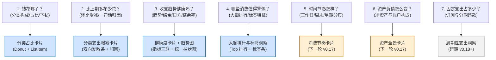
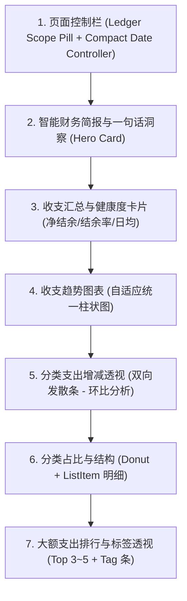
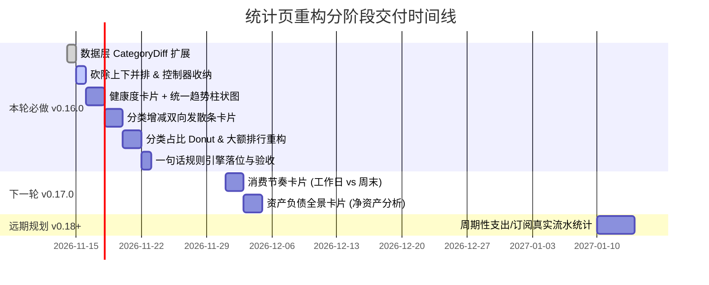

# OmniFlow 统计页重构产品规格与技术落地方案 (v1.0)

> **文档性质**：统计页（AnalyticsScreen）重构的最高产品规格与开发指导基准。  
> **设计基准**：严格遵循 [Material Design 系统与组件落地规范 (v1.0)](file:///home/hatch/Repos/omni-flow/docs/material-design-standard-v1.md)，对标主流成熟 Android/iOS（参考青子记账信息结构），杜绝页面自造视觉语言。  
> **工程约束**：坚持分层架构，UI 无关的聚合逻辑沉淀于 `:core` 模块，Composable 仅负责状态渲染与事件分发；金额与统计计算口径保持严谨一致，严禁改版引入口径漂移；本地构建与测试全量验证。

---

## 1. 产品核心：用户来统计页到底要获得什么？

统计不是流水账的简单图形堆叠，而是帮助用户建立**财务感知、发现消费异动、指导未来决策**的控制台。本章从产品经理视角逐一推导 7 个核心用户问题，并诚实核验当前 `:core` 模块的数据支撑能力。

---

### 问题 1：我这个月钱花哪了？（分类构成、占比变化、二级分类下钻）
* **用户问题**：我这周/月/年钱主要流向了哪些生活维度？各分类占总支出的比例是多少？餐饮花了多少，里面外卖多还是堂食多？
* **需要的数据**：
  * 所选周期内支出（或收入）的总额；
  * 各一级分类的金额与占总额百分比（从大到小排序）；
  * 各一级分类下挂的二级分类金额与占比。
* **最合适呈现**：
  * **环形图（Donut Chart）**：中心展示总支出与分类总数，弧线带呼吸间隙与触控高亮；
  * **分类进度条列表（List with LinearProgress）**：`ListItem` 结构，左侧分类图标与名称，中间进度条（按该分类占总额比例填色），右侧显示精确金额与等宽百分比（`tnum`）；
  * **级联控制**：右上角提供“仅一级 / 含二级”紧凑切换（FilterChip 或微型分段）。
* **可下钻交互**：
  * 点击环形图扇区：高亮对应分类，列表中滚动并定位到该分类；
  * 点击分类列表行：打开「分类流水抽屉（BottomSheet）」，列出该周期内该分类下的全部明细交易，点击交易可直接跳转查看或编辑流水。
* **数据层（`:core`）能力核验**：
  * **支持现状**：完全支撑。`SqlDelightAnalyticsFacade.categoryBreakdowns()` 已经按一级分类与二级分类进行了两级嵌套聚合，产出 `CategoryBreakdownItem`。
  * **本轮动作**：列入本轮。补全点击分类弹出流水明细抽屉的交互。
  * **工作量**：**S**（纯 UI 与事件绑定）。

---

### 问题 2：我比上个月/去年同期多花还是少花了？为什么？（环比/同比增减、一句话归因）
* **用户问题**：我这个月是省了还是超支了？比上个月多了几千块到底是因为出去旅游了一趟，还是日常餐饮失控了？
* **需要的数据**：
  * 本期总额 vs 上期总额，差额 $\Delta = \text{Amount}_{\text{current}} - \text{Amount}_{\text{previous}}$；
  * 各分类的本期金额 vs 上期同期金额，计算每个分类的增减差额；
  * 识别最大增幅分类（主要推手）与最大降幅分类（省钱功臣）。
* **最合适呈现**（借鉴青子 07-13 结构，落地为 M3 容器）：
  * **Hero 归因卡片**：顶部大字展示“比上月同期多花 ¥X.XX”（多花用 `error` 语义红，少花用语义绿），副文案输出规则一句话归因（如：“社交和旅行是主要增加来源”）；
  * **双向发散条形图（Horizontal Diverging Bars）**：中间为 0 基准线，左侧延伸为“少花（绿）”，右侧延伸为“多花（红）”，按变动绝对值排序展示 Top 3~5 分类；
  * **底部三联小计**：本期总支出 | 上期总支出 | 较上期变动。
* **可下钻交互**：
  * 点击任意分类增减条：展开该分类两期对比详情（本期流水 vs 上期流水）。
* **数据层（`:core`）能力核验**：
  * **支持现状**：部分支撑。`SqlDelightAnalyticsFacade` 已经在查询 `observeRows(previousRange)` 并计算了 `previousSummary`，但**尚未对上期数据做分类维度分组，缺乏分类级差额对比**。
  * **本轮动作**：列入本轮。在 `:core` 模块补充 `categoryDiffs` 聚合函数（输入本期与上期流水列表，产出 `List<CategoryDiffItem>`），纯 Kotlin 集合操作，无需改动 SQLite schema。
  * **工作量**：**M**（`:core` 增加对比用例与单元测试 0.5d，`:app` 绘制双向发散图卡片 1d）。

---

### 问题 3：我的收支趋势健康吗？（趋势、累计对比、日均、结余与结余率）
* **用户问题**：我的收支节奏稳不稳定？月底能不能存下钱？结余率是多少？平均一天花多少？
* **需要的数据**：
  * 时间序列收支点：按日（周/月周期下）或按月（年周期下）的支出与收入时序；
  * 健康度指标：总收入、总支出、净结余（$\text{Income} - \text{Expense}$）、结余率（$\frac{\text{Net}}{\text{Income}} \times 100\%$）、日均支出（$\frac{\text{Expense}}{\text{Days}}$）。
* **最合适呈现**：
  * **财务健康度指标卡片（Summary Card Row）**：放弃首页原样照搬的死板三张卡，重塑为带有 M3 语义指示的高密容器：净结余（加大加粗）、结余率 Badge（结余率 $\ge 20\%$ 显示健康绿，$< 0$ 显示预警红）、日均支出；
  * **统一周期趋势图（Unified Trend Bar Chart）**：根据选中的周/月/年自适应：
    - 周模式：7 根柱（周一到周日）；
    - 月模式：当月 1~31 日每日收支柱体（彻底废除当前月模式下展示 12 个月的畸形逻辑）；
    - 年模式：1~12 月每月并排双柱（收左支右）。
* **可下钻交互**：
  * 点击柱体：高亮该日/该月，浮现 Tooltip 气泡展示当日精确收支金额；双击或点击气泡查看当日流水。
* **数据层（`:core`）能力核验**：
  * **支持现状**：完全支撑。`SqlDelightAnalyticsFacade` 的 `chartData` 已完整支持按 `DAY` / `WEEK` / `MONTH` 统计 `ChartPoint`。当前 `OmniFlowViewModel` 在 `MONTH` 模式下已经传入了 `TimeGranularity.DAY`，是旧 UI 强行渲染了年度卡片。
  * **本轮动作**：列入本轮。UI 层面彻底用统一趋势图替代畸形的 `YearBars`。
  * **工作量**：**S**（UI 统一）。

---

### 问题 4：哪些大额、异常或冲动消费值得我注意？（大额排行、标签特征）
* **用户问题**：这个月最狠的几笔花销是什么？有没有不在计划内的大件支出？带有“冲动消费”或“人情往来”标签的钱花了多少？
* **需要的数据**：
  * 周期内单笔交易按金额降序排列（Top 3~10）；
  * 标签聚合：各标签的累计金额与笔数（包含无标签）。
* **最合适呈现**：
  * **大额支出排行卡片（Top Expenses Card）**：M3 `ListItem` 标准槽位，1/2/3 强化序号徽标，分类图标，主标题显示 `一级分类 - 二级分类`，副标题显示 `日期 · 账户 · 备注`，右侧突出大字体金额；提供“展开更多 / 收起”；
  * **消费标签透视卡片（Tag Breakdown Card）**：标签名称、笔数、总额以及横向进度条。
* **可下钻交互**：
  * 点击排行中的交易：直接打开交易详情模态弹窗（`TransactionRecordDetailSheet`），可立即调整分类、补齐标签或查看原始凭证。
* **数据层（`:core`）能力核验**：
  * **支持现状**：完全支撑。`ranking`（`TransactionRankingItem`）与 `tagAnalysis`（`TagAnalysisItem`）均已由 `:core` 稳定输出。
  * **本轮动作**：列入本轮。升级为标准 M3 `ListItem` 视觉与点击直达交易详情。
  * **工作量**：**S**（UI 升级）。

---

### 问题 5：我的钱在时间上是什么节奏？（按周几、按月的消费节奏、日历热力）
* **用户问题**：我平时是不是一到周末就报复性消费？周一到周五节制、周末失控吗？
* **需要的数据**：
  * 按星期（周一至周日）7 个时段的平均支出或总支出汇总；
  * 工作日（周一至周五）日均 vs 周末（周六至周日）日均支出对比。
* **最合适呈现**：
  * **消费节奏卡片**：工作日 vs 周末双柱对比，或周一至周日 7 根垂直柱形热力分布，附一句话洞察（如：“周末日均消费 ¥380，是工作日的 2.4 倍”）。
* **可下钻交互**：
  * 点击“周末”：筛选出当月所有周六、周日的流水明细。
* **数据层（`:core`）能力核验**：
  * **支持现状**：暂无现成结构。需在 `:core` 增加按 DayOfWeek 的统计聚合。
  * **本轮动作**：**下一轮（v0.17.0）实施**。本轮先通过问题 3 的每日趋势图覆盖时间维度的消费感知，避免本轮需求膨胀。
  * **工作量**：**M**（新增聚合与图表组件）。

---

### 问题 6：我的资产和负债在怎么变？（净资产趋势、账户构成分析）
* **用户问题**：我的钱都在哪？银行卡、微信零钱、支付宝各占多少？负债率高不高？
* **边界划分与产品纪律**：
  - **“更多”页（MoreScreen）**：定位为**管理操作中心**（账户新增/修改、修改余额、银行卡对账、隐藏账户等）；
  - **“统计”页（AnalyticsScreen）**：定位为**只读分析与全景透视**，展示总资产/总负债/净资产比例与账户分布，严禁放置管理操作按钮。
* **需要的数据**：
  * 全局账户快照：总资产、总负债、净资产；
  * 各账户当前余额与类型占比（现金、借记卡、信用卡、电子钱包、投资）。
* **最合适呈现**（参考青子 06-10，落实 M3 规范）：
  * **资产负债全景卡片**：净资产 Hero 金额，资产/负债横向双色比例条；账户类型占比堆叠图与各账户余额排行榜。
* **数据层（`:core`）能力核验**：
  * **支持现状**：`:core` 的 `ManagementFacade` 支持 `observeAccountSummary()`，但目前统计页 ViewModel 只订阅了 `AnalyticsFacade`，尚未融合资产流。
  * **本轮动作**：**下一轮（v0.17.0）实施**。本轮集中精力打穿收支分析核心；资产总览卡片暂时留在“更多”页顶部。
  * **工作量**：**M**（ViewModel 组合状态与构建资产图卡片）。

---

### 问题 7：固定/周期性支出占多少？（订阅与还款等已有数据能支撑的洞察）
* **用户问题**：我每个月有多少刚性支出（房租、车贷、信用卡分期、各类会员订阅）？
* **需要的数据**：
  * 周期性支出发生额与预期额。
* **数据层（`:core`）现状真实核查**：
  * OmniFlow 的 SQLite 中存在 `reminder` 表，定义了 `ReminderType.SUBSCRIPTION` 和 `REPAYMENT` 的重复规则与金额；
  * **核心断层**：**当前的 `transaction_record` 交易流水表中并没有与 `reminder` 建立任何外键关联，也没有定时自动记账生成真实扣款流水的机制！**
  * **严正结论**：当前数据层**完全不支持**实际周期性支出的真实统计！如果仅拿 Reminder 预设金额进行静态估算，会与真实记账数据脱节，误导用户财务决策。
* **规划策略**：**明确列为远期项（v0.18.0+）**，等待后续完成“周期性提醒自动记账/流水关联”核心引擎建设后，再行推出。杜绝虚构伪统计。

---

### 7 大核心问题与落地轮次矩阵表

| 序号 | 核心用户问题 | 核心呈现形式 | `:core` 数据层现状 | 落地规划 | 预估工作量 |
| :--- | :--- | :--- | :--- | :--- | :--- |
| **Q1** | **我这个月钱花哪了？** | 环形图 + 分类进度条列表 + 二级展开 | 完全支撑（`categoryBreakdowns`） | **本轮必做 (v0.16.0)** | **S** |
| **Q2** | **我比上期多花还是少花？为什么？** | 双向发散对比条 + 增减归因一句话 | 部分支撑（已有两期总额，缺分类级对比） | **本轮必做 (v0.16.0)** | **M** |
| **Q3** | **我的收支趋势健康吗？** | 健康度卡片（日均/结余/结余率）+ 统一柱状图 | 完全支撑（支持 DAY/WEEK/MONTH） | **本轮必做 (v0.16.0)** | **S** |
| **Q4** | **哪些大额/冲动消费值得注意？** | 大额排行 Top 5 (ListItem) + 标签分析条 | 完全支撑（`ranking` + `tagAnalysis`） | **本轮必做 (v0.16.0)** | **S** |
| **Q5** | 我的钱在时间上是什么节奏？ | 工作日 vs 周末对比柱图 / 星期分布 | 缺周内按星期聚合用例 | 下一轮 (v0.17.0) | M |
| **Q6** | 我的资产和负债在怎么变？ | 净资产 Hero + 账户占比横向堆叠条 | 支撑存量查询，需融合至统计 ViewModel | 下一轮 (v0.17.0) | M |
| **Q7** | 固定/周期性支出占多少？ | 订阅与还款刚性支出占比 | 数据层交易无外键关联，不支持真实统计 | 远期规划 (v0.18+) | L |

---

## 2. 页面重构开发规格

### 2.1 页面整体架构与自上而下区块顺序

页面遵循**“先给结论与核心洞察，再看结构拆解，最后下钻明细细节”**的信息消费规律，坚决避免把次要图表或操作杂项堆在首屏：

#### 各区块业务价值与排列理由：
1. **页面控制栏（Header Controls）**：单手可及的紧凑顶部控制条，确定当前统计的“账本范围”与“时间周期”；
2. **智能财务简报卡片（Hero Insight Card）**：打开统计页 0.5 秒内必须映入眼帘的结论：“本月结余健康，较上月同期少花 ¥520，餐饮支出降幅最大”；
3. **收支汇总与健康度卡片（Health Summary Card）**：总收入、总支出、净结余、结余率、日均支出。给财务状况定性；
4. **收支趋势图表（Trend Section）**：时间维度的变化轨迹，发现哪几天集中爆款花销；
5. **分类支出增减透视（Diff Section）**：直接解答“为什么比上月花得多/少”，紧扣环比差异归因；
6. **分类占比与结构（Category Share Section）**：钱流向哪里的全景饼图与清单；
7. **大额支出排行与标签透视（Rank & Tag Section）**：微观细节，锁定具体的单笔大额交易与非理性消费标签。

---

### 2.2 控制器与切换组件收纳规格

#### (1) 现状问题严查
当前页面堆砌了**三个整行全宽的自绘控件（OmniSegmented）**：
1. 时间范围切换（周/月/年/范围）占满一行；
2. 支出/收入切换占满一行；
3. YearBars 内的“上下(DIVERGING)/并排(SIDE_BY_SIDE)”切换占了一整块控件。  
*视觉后果*：页面被巨大药丸按钮割裂得七零八落，真正有效的数据图表被挤出首屏。

#### (2) 页面级切换控制重构方案
遵循 M3 原生组件选型，**全页严格限制页面级切换为 1 组，其余局部筛选就地下沉**：

* **时间周期选择（Page-level）**：
  * **组件**：M3 原生 `SingleChoiceSegmentedButtonRow`；
  * **样式**：高度压紧至 `36.dp`（紧凑型），使用 `surfaceContainerHigh` 轨道与 `secondaryContainer` 激活背景；
  * **布局咬合**：与下方的 `RangeStepper`（上周期/下周期切换）紧密组合在同一卡片顶部，消灭原本分散占位的空白。
* **收支类型切换（Section-level 下沉）**：
  * **裁决**：**坚决取消跨越全页的独立大收支分段条！**
  * **落地**：收支切换下沉至具体卡片右上角。在“分类占比”与“大额排行”卡片的标题栏右侧，放置紧凑型 `SingleChoiceSegmentedButtonRow`（高度 `32.dp`，只含支出/收入图标或文字），用户在看该卡片时就地切换，不破坏其他区块上下文。
* **账本筛选（Scope Pill）**：
  * 维持顶部的紧凑药丸胶囊 `LedgerScopePill`，融入 M3 `AssistChip` 规范。

#### (3) 核心焦点裁决：“上下/并排”切换按键的彻底解决
* **痛点定性**：产品负责人严正指出“上下/并排切换键太丑，一个次要的图表呈现选项不配占一整行大控件”。
* **产品与架构终审结论**：**彻底删除“上下/并排”用户切换控件！**
* **专业裁决理由**：
  1. **降低认知负担**：财务应用的核心价值是“清晰如实地传达数据”，而不是提供“图表样式玩具盒”。让用户在“上下看”和“并排看”之间做选择，属于产品经理未能做出最优设计决策而推卸给用户的典型设计失职；
  2. **信息表达的最优形态归位**：
     - **收支对比（双变量绝对值对比）**：**并排柱状图（Side-by-side Bars）具有压倒性的信息识别优势**。人类视觉对基准线对其的两个高度差异最为敏感，并排柱能一目了然看清当期是收大于支还是支大于收；而上下发散柱两头向外生长，必须在大脑中进行空间距离换算，反人类直觉；
     - **增减变动（正负差额对比）**：**水平双向发散条（Horizontal Diverging Bars）是差额对比的最佳形态**。正数向右（红/增），负数向左（绿/减），中间有明确的 0 轴。
  3. **落地执行**：
     - 年度/月度时间趋势图：**永久固定为“并排双柱图”（Side-by-side）**；
     - 分类增减对比图：**永久固定为“水平发散条”（Diverging）**；
     - 彻底从 UI 和 ViewModel 代码中移除 `BarLayout` 枚举及对应分段选择器，释放宝贵视觉空间。

---

## 3. 图表与数据卡片清单

### 3.1 财务健康度汇总卡片 (Health Summary Card)
* **容器规格**：`ElevatedCard`，容器色 `surfaceContainerLow`，圆角 16dp，内边距 16dp。
* **排版结构**：
  * **主 Hero 行**：
    * 标题：“净结余”，金额采用 `HeadlineMedium` + `tnum`（加粗），若结余 $\ge 0$ 赋予 `incomeColor`，若为负赋予 `error`；
    * 右侧挂载 **结余率 Badge**：M3 `SuggestionChip` 胶囊，显示例如 `结余率 32.5%`（健康绿）或 `超支 -12.4%`（预警红）。
  * **副指标三联行**（组间使用微细垂直分割线）：
    * **总收入**：`TitleMedium`，金额绿色；
    * **总支出**：`TitleMedium`，金额加重黑/白；
    * **日均支出**：`TitleMedium`，自动除以当前周期天数（如月天数或截至今日天数）。
* **交互**：点击总支出/总收入，呼出该周期流水清单。
* **空状态降级**：无交易记录时，金额显示 `¥0.00`，结余率显示 `--`。

---

### 3.2 周期收支趋势图卡片 (Trend Card)
* **容器规格**：`ElevatedCard`，圆角 16dp。
* **图表类型**：自适应并排双柱图（Side-by-side Bar Chart）。
  * **周视图**：7 对柱子（周一至周日）；
  * **月视图**：当月 1~31 日每日柱状图（平铺或横向平滑布局，柱宽 6dp，柱顶圆角 2dp）；
  * **年视图**：1~12 月 12 对双柱（柱宽 10dp，柱顶圆角 4dp，收入柱靠左绿底，支出柱靠右红底）。
* **交互设计**：
  * **点击柱体**：被选中的柱体获得高亮轮廓，图表上方滑入 Tooltip 悬浮胶囊：展示选中日/月的具体日期、收入金额、支出金额、结余；
  * **双击/点击胶囊**：联动跳转查看该日记账流水。
* **无障碍与降级**：
  * **语义朗读**：每个柱形容器配置 `contentDescription = "${point.label}，收入${income}元，支出${expense}元"`；
  * **无障碍图形区隔**：不能仅靠颜色区分收支，收入柱采用纯色实心填充，支出柱采用轻微斜向纹理或顶部带有微型横标线。
  * **数据稀疏降级**：若全周期仅 1~2 笔记录，正常绘制单柱，不强行填充满屏，居中显示引导“记录更多天数以呈现完整趋势”。

---

### 3.3 分类支出增减卡片 (Category Diff Card)
* **容器规格**：`ElevatedCard`，圆角 16dp。
* **图表类型**：水平双向发散条形图（Horizontal Diverging Bar Chart）。
* **数据来源**：本期各分类支出 vs 上期同期各分类支出。
* **视觉与槽位**：
  * **头部**：标题“分类支出增减”，右侧副标题注明对比区间（如 `10/1 - 10/24 · 对比 9/1 - 9/24`）；
  * **中部 Hero**：展示变动总差额，“比上期多花 ¥1,246.70”，辅以规则归因文本；
  * **图表本体**：
    * 中间设立 `0` 轴中线（1dp `outlineVariant`）；
    * 轴左侧为“少花（省钱）”，绿色条向左延伸；
    * 轴右侧为“多花（超支）”，红色条向右延伸；
    * 展示变动绝对值最大的 Top 4 个分类，每行展示：分类图标、名称、条形、变动额（带 `+` / `-` 符号与箭号）。
* **交互**：
  * 点击任意分类条：展开弹窗显示该分类在本期与上期的具体交易对比列表。
* **降级呈现**：
  * 若上期完全无数据（例如用户第一个月使用 App）：卡片优雅降级，展示文案“暂无上期对比数据，下月此时将自动生成环比增减分析”。

---

### 3.4 分类占比与构成卡片 (Category Share Card)
* **容器规格**：`ElevatedCard`，圆角 16dp。
* **图表类型**：M3 现代环形图（Donut Chart）+ 分类明细列表。
* **视觉与槽位**：
  * **头部**：左侧“分类占比”，右侧嵌入紧凑 `SingleChoiceSegmentedButtonRow`（支出 / 收入 切换）；
  * **环形图**：直径 180dp，环宽 26dp，扇区间保留 2 度安全间隙。中心两行文字：总金额（`HeadlineSmall` + `tnum`）+ 分类总数；
  * **子级切换**：列表上方右侧微型开关“仅一级 | 含二级”；
  * **分类列表**：M3 `ListItem` 标准实现：
    - `leadingContent`: 32dp 分类圆形背景与矢量图标；
    - `headlineContent`: 分类名称（包含二级时显示 `一级分类 - 二级分类`）；
    - `supportingContent`: M3 `LinearProgressIndicator` 进度条（对应当前分类占比进度）；
    - `trailingContent`: 右对齐两行，上方为金额，下方为等宽百分比（`tnum`，如 `44.1%`）。
* **交互**：
  * 点击环形图扇区：列表联动高亮对应分类项并震动手感反馈；
  * 点击分类列表行：打开分类明细流水抽屉（BottomSheet）。
* **降级呈现**：无数据时展示空圆环虚线框与“当前周期无记账分类”文字。

---

### 3.5 大额支出排行卡片 (Top Expenses Card)
* **容器规格**：`ElevatedCard`，圆角 16dp。
* **图表类型**：高对比度排行列表（Top Ranking List）。
* **视觉与槽位**：
  * 列表项标准：
    - 排名 1/2/3 赋予 M3 Expressive 彩色角标（金/银/铜或主题强调色），4 以后为中性低调数字；
    - 分类图标（带 36dp 容器）；
    - 标题：`一级分类 - 二级分类`；
    - 副标题：`交易日期 · 账户名称 · [备注内容]`（单行截断省略）；
    - 尾部：单笔金额（粗体，`error` 语义红或常规白）。
  * 底部操作：若总笔数 $> 3$，显示“查看全部 (共 X 笔)”展开按钮。
* **交互**：
  * 点击任意条目：直接打开全屏/半屏 `TransactionRecordDetailSheet`，可直接编辑流水或重新打标签。
* **降级呈现**：若笔数为 0，显示“当前周期无大额支出”。

---

### 3.6 标签透视卡片 (Tag Breakdown Card)
* **容器规格**：`ElevatedCard`，圆角 16dp。
* **图表类型**：带条状比例的横向柱状列表。
* **视觉与槽位**：
  * 展示 `#冲动消费`、`#人情往来`、`#旅行专项` 等自定义标签的金额与笔数；
  * 进度条根据标签金额占总支出的比例自适应长度。
* **交互**：点击标签进入搜索页查看该标签下的全部流水。
* **降级呈现**：若用户未给任何交易打标签，整张卡片隐式收起，不占用页面高度。

---

## 4. 基于规则的“一句话洞察”机制

统计页不仅呈现冰冷数字，必须提供**可解释、易理解的规则化财务洞察**。本机制完全基于现有数据层特征驱动，**零 AI 虚构依赖，零网络调用，100% 确定性生成**。

### 4.1 规则优先级与文案模板库（核心 6 条）

#### 规则 1：异动归因规则（超支主力发现）
* **触发条件**：本期总支出比上期增加 $\ge 15\%$，且某一分类贡献了增加额的 $40\%$ 以上。
* **数据变量**：`topIncreaseCategory`（增量最大分类），`diffAmount`（总增加额），`categoryDiff`（该分类增加额）。
* **文案模板**：
  > “本期支出较上期增加 **{diffAmount}**，其中 **{topIncreaseCategory}** 增加了 **{categoryDiff}**，是主要增加来源。”
* **示例**：“本期支出较上期增加 **¥1,420.00**，其中 **数码数码** 增加了 **¥1,200.00**，是主要增加来源。”

#### 规则 2：省钱成就规则（节流表彰）
* **触发条件**：本期总支出比上期减少 $\ge 10\%$，且净结余率 $\ge 25\%$。
* **数据变量**：`decreaseAmount`（减少金额），`topSavedCategory`（节约最多分类）。
* **文案模板**：
  > “控制得力！本期较上期少花 **{decreaseAmount}**，**{topSavedCategory}** 支出明显缩减，结余表现优秀。”
* **示例**：“控制得力！本期较上期少花 **¥860.50**，**外卖餐饮** 支出明显缩减，结余表现优秀。”

#### 规则 3：单点失衡规则（极端大额预警）
* **触发条件**：排行榜第一名（Top 1 单笔交易）占本期总支出比例 $\ge 35\%$。
* **数据变量**：`top1Category`，`top1Amount`，`top1Ratio`。
* **文案模板**：
  > “注意：**{top1Category}** 发生了一笔 **{top1Amount}** 的大额开支，占到本期总支出的 **{top1Ratio}%**。”
* **示例**：“注意：**家居装修** 发生了一笔 **¥4,500.00** 的大额开支，占到本期总支出的 **48.2%**。”

#### 规则 4：分类集中度规则（单一分类主导）
* **触发条件**：某一分类占本期总支出比例超过 $50\%$（排他性主导）。
* **数据变量**：`dominantCategory`，`dominantRatio`。
* **文案模板**：
  > “本期消费高度集中在 **{dominantCategory}**，占总支出的 **{dominantRatio}%**，请关注分类构成是否合理。”
* **示例**：“本期消费高度集中在 **住房房租**，占总支出的 **56.3%**，请关注分类构成是否合理。”

#### 规则 5：赤字预警规则（收不抵支）
* **触发条件**：本期总支出 $>$ 总收入，且总收入 $> 0$。
* **数据变量**：`deficitAmount`（赤字额），`expenseRatio`（收支比）。
* **文案模板**：
  > “当前支出已超出收入 **{deficitAmount}**，收支比达 **{expenseRatio}%**，建议适度紧缩非刚性开支。”
* **示例**：“当前支出已超出收入 **¥1,120.00**，收支比达 **118.5%**，建议适度紧缩非刚性开支。”

#### 规则 6：基础平衡规则（平稳默认态）
* **触发条件**：收支变动在 $\pm 10\%$ 波动区间内，收支平衡。
* **数据变量**：`savingsRate`（结余率），`dailyAverage`（日均支出）。
* **文案模板**：
  > “收支节奏平稳，当前结余率为 **{savingsRate}%**，日均支出 **{dailyAverage}**。”
* **示例**：“收支节奏平稳，当前结余率为 **28.4%**，日均支出 **¥112.50**。”

---

## 5. 分阶段落地实施路线图

严守“不把重构变成烂尾工程”的原则，将统计页改造切分为三个清晰里程碑。

### 5.1 本轮必做（随 v0.16.0 发布交付）
| 改动项 | 涉及模块 | 改动内容简述 | 依赖基线 | 工作量 |
| :--- | :--- | :--- | :--- | :--- |
| **数据层扩展** | `:core` | `SqlDelightAnalyticsFacade` 补充 `categoryDiffs` 计算与单元测试 | 无 | **M** |
| **控制器瘦身** | `:app` | 废除自绘 `OmniSegmented`；引入 M3 `SingleChoiceSegmentedButtonRow`；**彻底删除“上下/并排”切换按键** | M3 1.4.0 Tokens | **S** |
| **收支健康度卡片** | `:app` | 汇总卡重构：净结余、结余率 Badge、总收、总支、日均支出 | 无 | **S** |
| **统一趋势图** | `:app` | 统一为并排双柱图；适配周/月/年；点击高亮显示 Tooltip | 无 | **S** |
| **分类支出增减卡片** | `:app` | 水平双向发散条形图（少花绿/多花红）+ Top 4 差异排行 | `categoryDiffs` 数据 | **M** |
| **分类占比卡片重构** | `:app` | M3 环形图 + M3 `ListItem` 分类进度条列表 + 二级展开 | 无 | **S** |
| **大额排行升级** | `:app` | M3 `ListItem` 排行榜，支持点击直达交易详情模态弹层 | 现有数据层 | **S** |
| **一句话规则引擎** | `:app` | 本地确定性规则引擎，生成 Hero 归因洞察文案 | 差异数据 | **S** |

### 5.2 下一轮规划（随 v0.17.0 演进）
1. **消费节奏卡片（Time Rhythm Card）**：
   - `:core` 增加按 DayOfWeek（周一至周日）的聚合查询；
   - 前端绘制工作日 vs 周末日均支出对比图，揭示作息消费特征。（工作量：**M**）
2. **资产负债全景透视卡片（Asset Landscape Card）**：
   - 融合 `ManagementFacade` 资产流至统计页 ViewModel；
   - 呈现总资产、总负债、净资产时点比例与各账户分布。（工作量：**M**）

### 5.3 远期规划（v0.18.0+）
1. **真实订阅与周期性支出分析**：
   - 依赖底层“流水与提醒关联”及“自动生成周期记账”核心能力；
   - 呈现刚性支出占比与年度订阅摊销预测。（工作量：**L**）

---

## 6. 验收标准（Acceptance Criteria）

每项重构必须通过以下确定性标准的验证：

### 6.1 数据口径严谨性标准（硬性防线）
1. **金额计算零漂移**：
   - 统计页所有卡片（健康度、分类占比、趋势图、增减对比、大额排行）的汇总金额，必须使用精确整数分计算（`Money.minor`），严格杜绝使用浮点数累计引起的精度截断；
   - 统计周期内的总支出必须严格等于所有一级分类金额之和；
   - 增减卡片中的 `本期总支出 - 上期总支出` 必须数学恒等于 `较上期变动额`。
2. **排除标记严格生效**：
   - 标记为 `is_excluded = 1`（不计入收支）的交易，严禁渗入任何卡片的统计、趋势与排行中。

### 6.2 呈现与视觉标准
1. **控制器精简达标**：
   - 页面级分段选择器严格只保留 1 组（周/月/年/范围）；
   - **界面中绝对不存在任何“上下/并排”切换按键**，趋势图统一为并排双柱；
   - 卡片圆角统一为 16dp（`OmniRadius.medium`），卡片底色统一为 `surfaceContainerLow`，内边距严格为 16dp。
2. **文本与数字排版**：
   - 所有金额展示必须开启 `fontFeatureSettings = "tnum"`，数值变动不产生界面横向抖动；
   - 分类名严格遵循规范：有二级分类显示 `一级分类 - 二级分类`，无二级分类显示 `一级分类`；
   - 日期文本单行完整显示，精确反映当前选中范围（如 `10月1日 - 10月24日`）。

### 6.3 交互与无障碍标准
1. **下钻路径畅通**：
   - 点击分类占比行或分类增减行：呼出对应的流水明细抽屉（BottomSheet）；
   - 点击大额排行单笔流水：打开交易详情页并能正常执行删除或修改；
   - 点击趋势图柱体：Tooltip 悬浮胶囊准确展示该日/该月收支，背景平滑高亮。
2. **无障碍（TalkBack）达标**：
   - 每一个柱体、环形图扇区、列表项均配置完备的 `contentDescription`，包含时间、类型与金额朗读；
   - 图形信息严禁仅依赖颜色传递：支出与收入除红绿颜色外，必须伴随图标符号（`+` / `-`、箭头）或柱形端点形态特征。

### 6.4 构建与测试验证标准
改动完成后本地执行并通过以下验证门禁：
- `./gradlew :core:testDebugUnitTest`（包含新增的分类差异对比用例）
- `./gradlew :core:verifySqlDelightMigration`
- `./gradlew :app:assembleDebug`
- 严格保证首页（`HomeScreen`）与搜索页（`SearchScreen`）样式与功能 100% 零回退、零污染。
