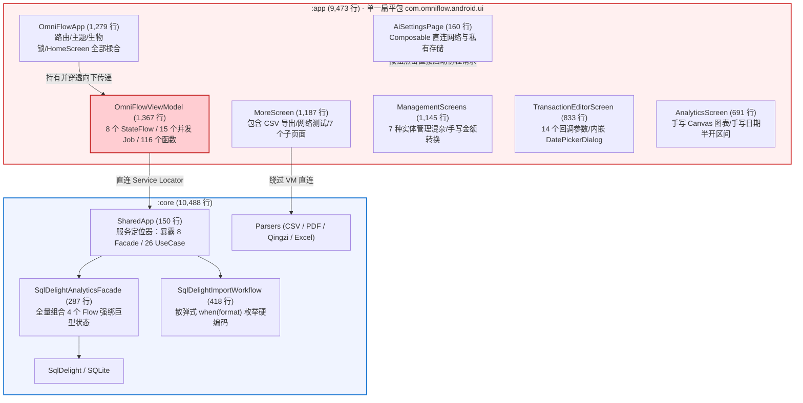
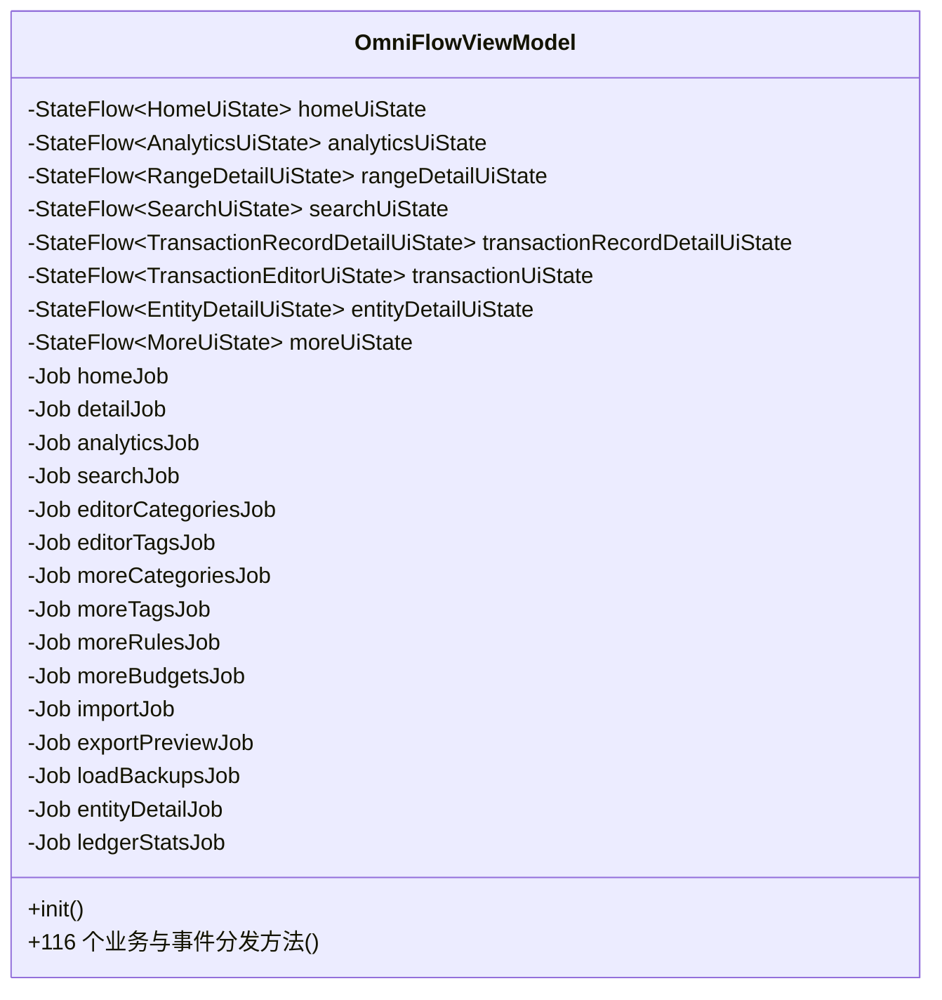
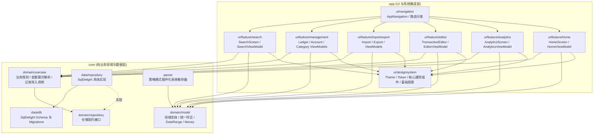
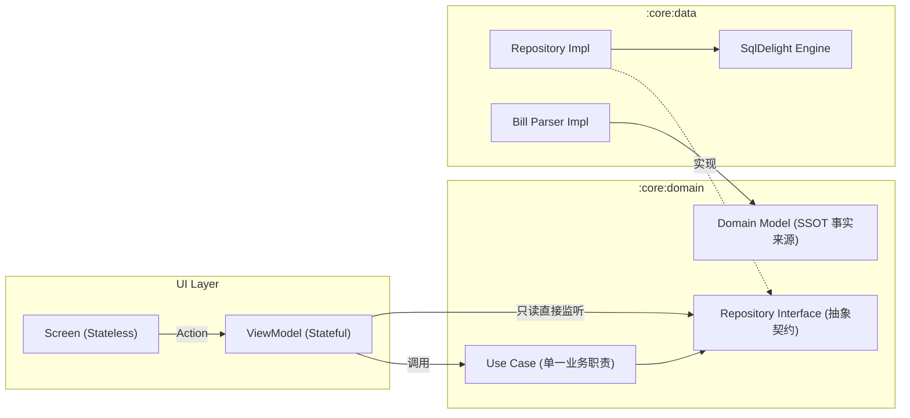
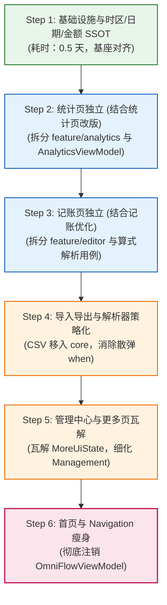
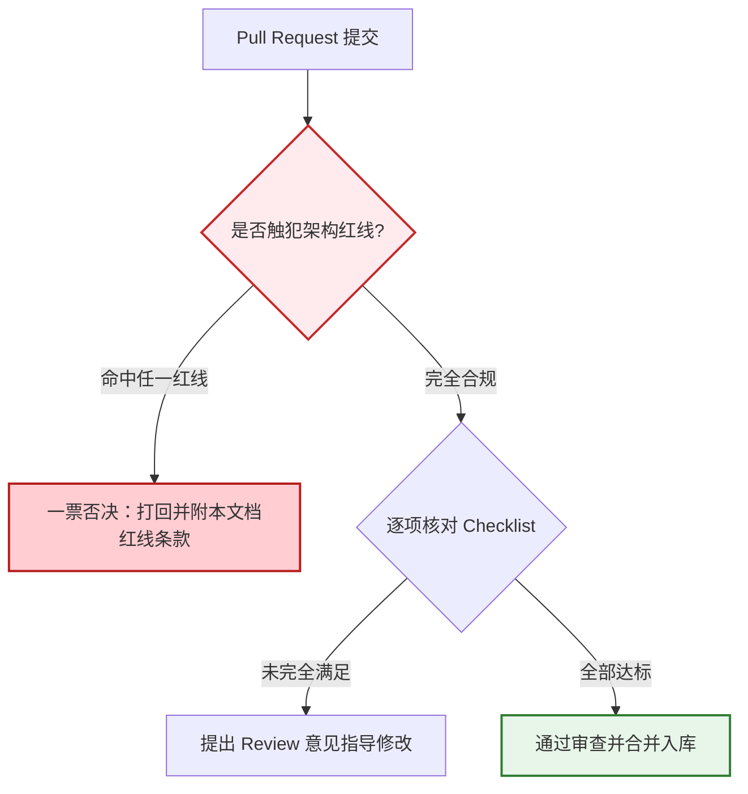

# OmniFlow 现代架构治理与工程规范 (v1.0)

> **文档性质**：项目最高架构治理基准与技术契约。本规范作为后续所有功能迭代（统计、记账、更多等）实现的硬门槛，由项目负责人（Muse）按本文档逐 PR 审查代码 Diff。  
> **核心原则**：严格对齐 [Android 官方现代应用架构指南（MAD）](https://developer.android.com/topic/architecture)；结合本仓库规模务实落地，拒绝为拆而拆与过度工程；坚持单向数据流（UDF）、关注点分离与单一事实来源（SSOT）；本地验证优先，任何架构违规一票否决。

---

## 1. 架构现状审计（量化数据与代码证据）

当前工程包含两个 Gradle 模块：`:app`（Android 应用程序）与 `:core`（Android 库）。全工程共计 19,961 行 Kotlin 代码，其中 `:app` 占 9,473 行，`:core` 占 10,488 行。通过对全量源码的依赖图谱与调用关系走查，暴露出以下严重的架构退化风险。



---

### 1.1 模块与分层审计

| 审计项 | 现状与证据 | 严重度 | 架构危害与破坏后果 |
| :--- | :--- | :---: | :--- |
| **业务逻辑沉入 Composable** | [MoreScreen.kt#L1068-L1138](file:///home/hatch/Repos/omni-flow/app/src/main/kotlin/com/omniflow/android/ui/MoreScreen.kt#L1068-L1138)：`exportJsonToCsv` 与 `escapeCsv`（纯 JSON 解析与 CSV 生成逻辑）直接写在 UI 文件的顶层函数中。<br>[ManagementScreens.kt#L1128-L1130](file:///home/hatch/Repos/omni-flow/app/src/main/kotlin/com/omniflow/android/ui/ManagementScreens.kt#L1128-L1130)：金额与浮点数转换扩展 `toDecimal()`、`toMoneyOrNull()` 定义在 Composable 文件末尾。 | **P0（致命）** | 业务逻辑脱离测试边界，UI 无法做轻量级自动化测试；跨端与模块复用彻底断绝。 |
| **UI 直调底层存储与外部网络** | [AiSettingsPage.kt#L47-L100](file:///home/hatch/Repos/omni-flow/app/src/main/kotlin/com/omniflow/android/ui/AiSettingsPage.kt#L47-L100)：Composable 直接通过 `AiCredentials.load/save(context)` 读写 SharedPreferences，并在按钮点击时通过 `scope.launch { AiCategoryAdapter(context).testConnection() }` 执行网络请求。<br>[MoreScreen.kt#L588-L596](file:///home/hatch/Repos/omni-flow/app/src/main/kotlin/com/omniflow/android/ui/MoreScreen.kt#L588-L596)：WebDAV 连接测试直接在 Composable 内调用 `WebDavSyncAdapter.testConnection`。<br>[OmniFlowApp.kt#L418-L420](file:///home/hatch/Repos/omni-flow/app/src/main/kotlin/com/omniflow/android/ui/OmniFlowApp.kt#L418-L420)：`dynamic_color` 设置直接在 Composable 中读写 SharedPreferences。 | **P0（致命）** | 违背单向数据流（UDF），配置状态与 UI 状态失去响应式同步；网络请求随 Composable 重组或生命周期销毁发生泄漏或中断。 |
| **外部适配器接口落位反转** | [SyncAdapter.kt](file:///home/hatch/Repos/omni-flow/core/src/main/kotlin/com/omniflow/core/data/sync/SyncAdapter.kt) 接口定义在 `com.omniflow.core.data.sync`（数据层实现包），由 `:app` 中的 `WebDavSyncAdapter.kt` 实现。 | **P1（严重）** | 依赖倒置原则（DIP）被打破。上层抽象接口应属于 `domain` 契约，而不应寄生在 `data` 具体技术方案下。 |
| **Core 模块 Android 耦合** | [AndroidSharedAppFactory.kt](file:///home/hatch/Repos/omni-flow/core/src/main/kotlin/com/omniflow/core/AndroidSharedAppFactory.kt) 位于 `:core` 模块根包下，引入 `android.content.Context` 与 `AndroidSqliteDriver`。 | **P2（中度）** | 限制了 `:core` 作为纯 Kotlin Multiplatform（KMP）或纯 JVM 运行的独立性，增加单元测试环境复杂度。 |

---

### 1.2 状态管理与 ViewModel 审计

全 App 仅有一个共享 ViewModel：[OmniFlowViewModel.kt](file:///home/hatch/Repos/omni-flow/app/src/main/kotlin/com/omniflow/android/ui/OmniFlowViewModel.kt)（共 1,367 行、116 个函数）。



1. **职责过载清单**：
   - **首页状态**：月份切换、日历选择、汇总展开、明细流卡片/列表模式；
   - **统计状态**：账本范围、时间跨度（周/月/年/自定义）、收支模式、报表穿透；
   - **搜索状态**：全文本过滤、账户/分类/标签多维交集、金额与日期区间；
   - **记账编辑状态**：输入键盘算式解析、账户与分类联动、标签多选、排除入账；
   - **导入/导出状态**：会话生命周期、格式推断、AI 分类建议、青子/CSV 双格式导出；
   - **全量基础数据治理**：账本 CRUD、账户调账/增删、分类多级排序/增删、规则引擎排重与顺序、提醒事项与周期调度、预算监控。
2. **状态类极度膨胀**：
   - `MoreUiState` 包含 **27 个字段**，将资产全景、导入预览（`ImportPreviewState`）、导出状态、WebDAV 备份列表、系统偏好设置、预算数据全部绑死在一起。导入界面的解析进度变更，会连带触发 MoreScreen 下挂所有无关 UI 树的重组检查。
3. **副作用与生命周期失控（常驻后台重算）**：
   - 在 `OmniFlowViewModel.kt#L244-L250` 的 `init` 块中，无条件常驻启动 `observeHome()`、`observeAnalytics()`、`collectManagement()`、`collectPreferences()`、`collectSync()`。
   - 未采用 `stateIn(viewModelScope, SharingStarted.WhileSubscribed(5000), ...)` 响应式生命周期，导致即使用户停留在设置页，任何交易表的变动都会导致后台立刻触发 `AnalyticsFacade.observeDashboard` 的 4 重 SQL 合并计算与排行榜排序，浪费 CPU 与电池。
4. **私藏关键业务逻辑**：
   - 键盘金额算式解析器 `evaluateAmount`（[OmniFlowViewModel.kt#L1340-L1365](file:///home/hatch/Repos/omni-flow/app/src/main/kotlin/com/omniflow/android/ui/OmniFlowViewModel.kt#L1340-L1365)）作为私有辅助函数埋在 ViewModel 最底部，零单元测试防护。

---

### 1.3 UI 组织与导航耦合审计

1. **上帝文件垄断代码库**：
   - `com.omniflow.android.ui` 包为纯扁平包，无任何业务子包。前 7 个文件代码行合计达 **7,090 行**，占整个 UI 层（8,826 行）的 **80.3%**：
     - `OmniFlowViewModel.kt`：1,367 行
     - `OmniFlowApp.kt`：1,279 行
     - `MoreScreen.kt`：1,187 行
     - `ManagementScreens.kt`：1,145 行
     - `TransactionEditorScreen.kt`：833 行
     - `AnalyticsScreen.kt`：691 行
     - `ImportPreviewScreen.kt`：588 行
2. **共享组件层边界混乱**：
   - `SharedControls.kt`（320 行）与 `ManagementComponents.kt`（275 行）定位严重重叠。例如：`LedgerScopePill`（药丸选择器）位于 `SharedControls.kt`，而 `LedgerPickerBar`（横向选择条）位于 `ManagementComponents.kt`；`LedgerCoverBox` 定义在 `ManagementComponents.kt`，却反向被 `SharedControls.kt` 的下拉菜单强依赖。
3. **设计系统 Token 脱节**：
   - `OmniTokens.kt#L21-L25` 规定全局圆角为 3 档（`small = 10.dp`, `medium = 16.dp`, `large = 22.dp`）；
   - 但在 [OmniFlowApp.kt#L254-L259](file:///home/hatch/Repos/omni-flow/app/src/main/kotlin/com/omniflow/android/ui/OmniFlowApp.kt#L254-L259) 中，`MaterialTheme` 的 `Shapes` 却配置为 `8.dp`, `12.dp`, `16.dp`, `28.dp`；其他页面又散落出现手写的 `RoundedCornerShape(8.dp)`（如 ManagementScreens.kt:371）。
4. **组件重复制造与遗留 View 控件**：
   - 全 App 存在 **4 处** 独立实现的 View 体系 `android.app.DatePickerDialog`，未收敛至 M3 Compose DatePicker，且各自手写月份 0 索引偏移计算：
     - [AnalyticsScreen.kt#L566](file:///home/hatch/Repos/omni-flow/app/src/main/kotlin/com/omniflow/android/ui/AnalyticsScreen.kt#L566)
     - [MoreScreen.kt#L1045](file:///home/hatch/Repos/omni-flow/app/src/main/kotlin/com/omniflow/android/ui/MoreScreen.kt#L1045)
     - [SearchScreen.kt#L467](file:///home/hatch/Repos/omni-flow/app/src/main/kotlin/com/omniflow/android/ui/SearchScreen.kt#L467)
     - [TransactionEditorScreen.kt#L672](file:///home/hatch/Repos/omni-flow/app/src/main/kotlin/com/omniflow/android/ui/TransactionEditorScreen.kt#L672)
5. **导航与页面深度咬合**：
   - [OmniFlowApp.kt](file:///home/hatch/Repos/omni-flow/app/src/main/kotlin/com/omniflow/android/ui/OmniFlowApp.kt) 名为应用入口，实为巨型杂烩：内嵌完整导航分发（166-580行）、主题配色引擎（608-720行）、生物识别门禁（767-840行）、首页核心视图 `HomeScreen`（841-943行）、交易日分组与卡片组件（944-1182行）、日期详情弹层 `DateDetailSheet`（1183-1264行）。
   - 导航存在双重分发：Navigation 3 分发到 `MoreScreen` 后，`MoreScreen` 内部又对 14 个 `MorePage` 做二次分支分发，并将 `viewModel` 强行逐层向下透传（Prop Drilling）。

---

### 1.4 数据层（Repository / Facade / UseCase）分工与走查推演

当前数据层职责分配存在严重不对称：
- **Repository**：提供底层数据 CRUD（`SqlDelightTransactionRepository` 等）；
- **Facade**：定位模糊。`BudgetFacade` 同时具备查询与写操作（`upsertBudget`/`deleteBudget`），而 `ManagementFacade` 仅提供只读 Flow，其增删改操作全部分散为 20 个极细粒度的 UseCase；
- **UseCase**：[SharedApp.kt#L80-L140](file:///home/hatch/Repos/omni-flow/core/src/main/kotlin/com/omniflow/core/SharedApp.kt#L80-L140) 将 26 个 UseCase 实例全部作为公共属性挂载；而 `SearchTransactionsUseCase` 更是反常地绕过 Repository，由 `SqlDelightSearchTransactionsUseCase` 直接手写 SQL 检索。

#### 走查场景 A：新增一个账单导入渠道（如“工商银行 ICBC”或“招商银行信用卡”）
在现有架构下，需要修改多达 **8 处文件**（经典的“散弹式修改”代码坏味道）：
1. [ImportFormat.kt](file:///home/hatch/Repos/omni-flow/core/src/main/kotlin/com/omniflow/core/parser/ImportFormat.kt)：在枚举中新增 `ICBC`。
2. [BillFormatDetector.kt](file:///home/hatch/Repos/omni-flow/core/src/main/kotlin/com/omniflow/core/parser/BillFormatDetector.kt)：编写文件头特征识别。
3. 新增解析器文件：如 `core/parser/pdf/IcbcPdfBillParser.kt`。
4. [SqlDelightImportWorkflow.kt](file:///home/hatch/Repos/omni-flow/core/src/main/kotlin/com/omniflow/core/data/facade/SqlDelightImportWorkflow.kt)：在 `detectFormat()`、`parse()` 中硬编码 `when(format)` 分支。
5. [ImportGrouping.kt](file:///home/hatch/Repos/omni-flow/core/src/main/kotlin/com/omniflow/core/domain/model/ImportGrouping.kt)：在 `groupKey` 的 `when(format)` 中增加聚合粒度分支。
6. [ImportCategoryDefaults.kt](file:///home/hatch/Repos/omni-flow/core/src/main/kotlin/com/omniflow/core/domain/model/ImportCategoryDefaults.kt)：若存在特定兜底规则需增加判断。
7. [SharedControls.kt#L226-L265](file:///home/hatch/Repos/omni-flow/app/src/main/kotlin/com/omniflow/android/ui/SharedControls.kt#L226-L265)：在 `ImportSourceIcon` 与 `ImportFormat.label` 的 `when` 分支中补充品牌色、Logo 资源与中文名称。
8. 单元测试文件：同步补充 2~3 个测试用例。

#### 走查场景 B：新增一个统计维度（如“按交易时段分布（早/中/晚/夜）”或“按商户排行”）
由于 `AnalyticsDashboardState` 是一个巨石数据包，新增维度将引发全面震荡，改动涉及 **6 处文件**：
1. `core/src/main/sqldelight/.../Transaction.sq`：补充时间段分组聚合 SQL。
2. [Analytics.kt](file:///home/hatch/Repos/omni-flow/core/src/main/kotlin/com/omniflow/core/domain/model/Analytics.kt)：新增领域模型 `TimeSlotBreakdownItem`，并在巨石类 `AnalyticsDashboardState` 中强行新增字段（破坏所有构造该状态的测试与调用点）。
3. [AnalyticsFacade.kt](file:///home/hatch/Repos/omni-flow/core/src/main/kotlin/com/omniflow/core/domain/facade/AnalyticsFacade.kt)：接口级联动。
4. [SqlDelightAnalyticsFacade.kt](file:///home/hatch/Repos/omni-flow/core/src/main/kotlin/com/omniflow/core/data/facade/SqlDelightAnalyticsFacade.kt)：在 `observeDashboard` 组合流中增加计算逻辑。
5. [SqlDelightSearchAnalyticsTest.kt](file:///home/hatch/Repos/omni-flow/core/src/test/kotlin/com/omniflow/core/data/SqlDelightSearchAnalyticsTest.kt)：修改既有测试断言。
6. [OmniFlowViewModel.kt](file:///home/hatch/Repos/omni-flow/app/src/main/kotlin/com/omniflow/android/ui/OmniFlowViewModel.kt) 与 [AnalyticsScreen.kt](file:///home/hatch/Repos/omni-flow/app/src/main/kotlin/com/omniflow/android/ui/AnalyticsScreen.kt)：修改 UI 渲染与状态分发。

---

### 1.5 测试防线现状审计

- **`:app` 模块测试近乎为零**：仅有 1 个测试文件 [WebDavHttpClientTest.kt](file:///home/hatch/Repos/omni-flow/app/src/test/kotlin/com/omniflow/android/WebDavHttpClientTest.kt)（45 行）。
  - **测试覆盖真空**：`OmniFlowViewModel`（0 个测试）、导航状态路由（0 个测试）、CSV 转换引擎（0 个测试）、金额算式计算器（0 个测试）、UI 格式化工具（0 个测试）、Compose UI 截图与交互测试（0 个）。
- **`:core` 模块拥有 29 个测试文件**：覆盖了 SQL 查询、解析器、同步引擎与基础 UseCase，但缺乏上层组合流与业务异常链路的防线。

---

### 1.6 其他可维护性风险清单（证据确凿）

| 风险类别 | 事实证据 | 潜在危害与典型 Bug 场景 |
| :--- | :--- | :--- |
| **时区口径分裂（精神分裂）** | [OmniFlowViewModel.kt#L1285](file:///home/hatch/Repos/omni-flow/app/src/main/kotlin/com/omniflow/android/ui/OmniFlowViewModel.kt#L1285)：命名为 `ChinaTimeZone`，实际值为 `TimeZone.currentSystemDefault()`。<br>[SqlDelightAnalyticsFacade.kt#L283](file:///home/hatch/Repos/omni-flow/core/src/main/kotlin/com/omniflow/core/data/facade/SqlDelightAnalyticsFacade.kt#L283)：同样为 `currentSystemDefault()`。<br>[SqlDelightImportWorkflow.kt#L416](file:///home/hatch/Repos/omni-flow/core/src/main/kotlin/com/omniflow/core/data/facade/SqlDelightImportWorkflow.kt#L416) 与各个解析器：硬编码 `TimeZone.of("Asia/Shanghai")`。 | 当用户在非东八区使用或出国旅行时，导入账单（解析为上海时间时间戳）与本地报表（按当前系统时间分天）发生错位，导致账单按自然日归集跨越午夜，出现金额对不齐。 |
| **金额口径在 UI 层外泄** | [AnalyticsScreen.kt#L482-L517](file:///home/hatch/Repos/omni-flow/app/src/main/kotlin/com/omniflow/android/ui/AnalyticsScreen.kt#L482-L517)：UI 循环中手算 `amount.minor.toFloat() / total.minor`、饼图扫角与百分比。<br>[ManagementScreens.kt#L380](file:///home/hatch/Repos/omni-flow/app/src/main/kotlin/com/omniflow/android/ui/ManagementScreens.kt#L380)：UI 手写 `balance.minor >= 0` 判定资产 vs 负债。<br>[ReminderScheduler.kt#L123](file:///home/hatch/Repos/omni-flow/app/src/main/kotlin/com/omniflow/android/ReminderScheduler.kt#L123)：通知栏拼接手写除以 100 格式化。 | 业务口径一旦在 `:core` 演进（如引入多币种、舍入模式或资产分类规则），UI 层计算逻辑立刻产生口径漂移，导致资产总额与明细总和不相等。 |
| **日期半开区间重复手写** | 共有 4 处文件手写 `LocalDate.plusDays(1)` 构造 `[startInclusive, endExclusive)`：<br>- [AnalyticsScreen.kt#L572](file:///home/hatch/Repos/omni-flow/app/src/main/kotlin/com/omniflow/android/ui/AnalyticsScreen.kt#L572)<br>- [MoreScreen.kt#L1062](file:///home/hatch/Repos/omni-flow/app/src/main/kotlin/com/omniflow/android/ui/MoreScreen.kt#L1062)<br>- [SearchScreen.kt#L481](file:///home/hatch/Repos/omni-flow/app/src/main/kotlin/com/omniflow/android/ui/SearchScreen.kt#L481)<br>- [OmniFlowViewModel.kt#L1291](file:///home/hatch/Repos/omni-flow/app/src/main/kotlin/com/omniflow/android/ui/OmniFlowViewModel.kt#L1291) | 重复逻辑一旦漏改其中一处（如时区转换漏考虑月末或闰年），将导致某些页面的查询截止时间丢失最后一整天的数据。 |
| **硬编码与资源归一缺失** | 全工程**不存在 `res/values/strings.xml`**。所有的界面文本、弹窗提示、按钮标签 100% 硬编码在 Kotlin 源码中。 | 无法支持国际化/本地化；文案微调必须重新编译代码；文案修改 PR 会污染业务代码提交记录。 |
| **单例 Service Locator 渗透** | [OmniFlowApplication.kt#L8](file:///home/hatch/Repos/omni-flow/app/src/main/kotlin/com/omniflow/android/OmniFlowApplication.kt#L8)：暴露 `sharedApp` 全局引用，[ReminderReceiver.kt#L131](file:///home/hatch/Repos/omni-flow/app/src/main/kotlin/com/omniflow/android/ReminderScheduler.kt#L131) 直接强转 Application 获取数据。 | 隐藏类之间的真正依赖关系，单元测试无法注入 Mock 驱动，产生强耦合。 |

---

## 2. 目标架构设计（现代 Android MAD 落地）

### 2.1 分层与模块策略：务实的双模块演进

> **明确决策**：**现阶段严格维持 `:app` 与 `:core` 双模块架构，严禁过早拆分 10+ 个 Gradle 模块（如 `:feature:*`、`:designsystem`）。UI 层全面落地 Package-by-Feature（按功能分包）。**



#### 为什么不现在拆分子 Gradle 模块？
1. **工程体量适中**：全工程仅 2 万行代码，单模块增量构建与测试耗时在 3~8 秒内。过早拆分模块会导致 Gradle 配置脚本膨胀、BOM 依赖版本同步复杂化。
2. **避免跨模块循环依赖陷阱**：记账、统计、导入、管理高度依赖共享领域模型（如 `Ledger`, `Account`, `Category`, `Transaction`）。若拆出 `:feature:analytics` 与 `:feature:editor`，仍需将公共逻辑下沉到数个 `:core:*` 模块，徒增工程认知负荷。

#### 触发拆分独立 Gradle 模块的硬性门槛（满足任意一条方可拆分）：
1. **构建耗时指标**：本地纯代码微调增量构建 `./gradlew :app:assembleDebug` 稳定超过 **30 秒**。
2. **代码规模指标**：工程总代码量突破 **50,000 行**，或某个 feature 子包代码量单独突破 **15,000 行**。
3. **动态下发需求**：产品规划引入 Google Play Feature Delivery（按需下载模块）或 Instant App。
4. **多端复用需求**：核心业务与解析引擎需要脱离 Android 编译为 iOS/Desktop 产物（KMP），此时优先将 `:core` 下的非 Android 逻辑抽为 `:core:domain`。

---

### 2.2 UI 层规范与 Package-by-Feature 结构

`:app` 模块按业务特性进行清晰纵向切分，杜绝扁平大包：

```
app/src/main/kotlin/com/omniflow/android/
├── OmniFlowApplication.kt
├── MainActivity.kt
└── ui/
    ├── navigation/                  # 导航中心（顶层路由、返回栈调度）
    │   ├── OmniRoute.kt             # Navigation 3 强类型路由定义
    │   └── OmniNavigationState.kt   # 导航状态持有者
    ├── designsystem/                # 设计系统层（无业务属性的基础组件）
    │   ├── theme/                   # M3 Expressive 主题、配色引擎、动效 Spring
    │   ├── tokens/                  # OmniTokens（统一 Space、Radius、Elevation）
    │   ├── components/              # ButtonGroup、ModalSheet、Pill、AmountText
    │   ├── chart/                   # 纯数据驱动图表基座（DonutChart、BarChart）
    │   └── icons/                   # SvgIcon、图标目录映射
    └── feature/                     # 业务功能垂直切片
        ├── home/                    # 首页与日历视图
        │   ├── HomeScreen.kt
        │   ├── HomeViewModel.kt
        │   ├── HomeUiState.kt
        │   └── components/
        ├── analytics/               # 统计大屏与报表（对齐 docs/analytics-redesign-v1.md）
        │   ├── AnalyticsScreen.kt
        │   ├── AnalyticsViewModel.kt
        │   ├── AnalyticsUiState.kt
        │   └── components/          # 专用卡片（TrendCard, RankingCard）
        ├── editor/                  # 记账弹层与编辑
        │   ├── TransactionEditorSheet.kt
        │   ├── TransactionEditorViewModel.kt
        │   ├── TransactionEditorUiState.kt
        │   └── components/          # 专用键盘与分类网格
        ├── importexport/            # 导入解析与备份导出
        │   ├── ImportPreviewScreen.kt
        │   ├── ImportViewModel.kt
        │   ├── ExportViewModel.kt
        │   └── components/
        ├── management/              # 实体管理（账本/账户/分类/标签/规则）
        │   ├── ledger/
        │   ├── account/
        │   ├── category/
        │   └── ...
        └── more/                    # 设置、安全锁、关于
            ├── MoreScreen.kt
            └── MoreViewModel.kt
```

#### ViewModel 拆分原则与生命周期治理
- **拆分硬性指标**：每个独立的顶层页面或全屏/底部复杂工作流（如记账弹层、导入会话）**必须拥有自己独立的 ViewModel**。严禁共享一个全局上帝 ViewModel。
- **状态流热度约定**：所有 ViewModel 对 UI 暴露的 StateFlow 必须使用 `stateIn` 并配合 `SharingStarted.WhileSubscribed(5000)`：
  ```kotlin
  val uiState: StateFlow<AnalyticsUiState> = analyticsRepository
      .observeDashboard(query)
      .map { it.toUiState() }
      .stateIn(
          scope = viewModelScope,
          started = SharingStarted.WhileSubscribed(5_000),
          initialValue = AnalyticsUiState.Loading,
      )
  ```
  **收益**：当用户切换离开该页面超过 5 秒后，底层 SQL 查询与 Flow 监听自动暂停，彻底消除后台无效计算与电池损耗。

#### Composable 状态提升与分层约定
所有 Screen 必须分为两层结构：
1. **Stateful Route（容器层）**：负责通过 `viewModel()` 获取 ViewModel，使用 `collectAsStateWithLifecycle()` 收集状态，负责将意图（Action）转发给 ViewModel，处理页面级导航跳转。
2. **Stateless Content（纯渲染层）**：只接受 `UiState` 和 `(UiAction) -> Unit` 事件回调，**严禁向子组件传递 ViewModel**。无状态组件支持 Compose Previews，方便独立走查深浅色与各状态。

---

### 2.3 Domain 与 Data 层规范



1. **UseCase 引入标准**：
   - **允许建 UseCase**：
     - 涉及跨多个 Repository 的复合业务协调（如 `CreateTransactionUseCase` 需要协同扣减账户余额、匹配规则、更新记账频次）；
     - 包含复杂、核心的业务验证或纯算法计算（如 `EvaluateAmountExpressionUseCase` 算式解析、`CalculateBudgetProgressUseCase`）；
     - 具有独立复用价值的操作。
   - **禁止建 UseCase**：
     - 仅对单个 Repository 方法做简单 1:1 透传包装的无意义样板类（如纯 `getAccount(id)`）。此类直接由 ViewModel 调用 Repository 契约方法。
2. **统一单一事实来源（SSOT）**：
   - **统一时区**：在 `:core:domain:model` 中定义全局标准时区对象 `AppTimeZone`。废止随意的 `currentSystemDefault()` 与局部写死 `Asia/Shanghai`。
   - **统一日期半开区间**：在 [DateRange.kt](file:///home/hatch/Repos/omni-flow/core/src/main/kotlin/com/omniflow/core/domain/model/DateRange.kt) 中提供完备工厂方法：`DateRange.ofMonth(...)`、`DateRange.ofDay(...)`、`DateRange.ofClosedDates(...)`。禁止在 UI 层自行手写 `plusDays(1)`。
   - **统一金额计算与格式化**：所有涉及货币乘除、比例计算、资产/负债判定，全部收敛至 `Money` 伴生对象与领域扩展；UI 层仅调用 `Money.asFormattedText()`，严禁在 Composable 内部提取 `minor` 做除法。
3. **导入解析器重构为策略模式（Plugin 架构）**：
   - 定义标准的 `BillParser` 接口：
     ```kotlin
     interface BillParser {
         val format: ImportFormat
         val displayName: String
         val brandColor: Long
         fun canParse(fileName: String, contentSample: ByteArray): Boolean
         suspend fun parse(bytes: ByteArray): Result<List<RawTransaction>>
     }
     ```
   - 新增导入渠道时，只需在 `:core:parser` 下新增一个实现类并注册到解析器注册表，彻底消灭散落在全工程的 8 处 `when(format)`。

---

### 2.4 硬规则与落位决策表

#### 单文件规模硬约束
- **硬性红线**：任何单个 Kotlin 文件代码量严禁超过 **400 行**。
- **预警门槛**：单文件超过 **300 行** 时，PR 审查必须要求提交者进行合理内部拆分或抽取子组件。

#### 新功能落位决策表（开发指南）

| 新增要素类别 | 物理落位模块与目录 | 归属分层 | 核心审查要点 |
| :--- | :--- | :--- | :--- |
| **新业务页面** | `app/ui/feature/<feature_name>/` | UI (Feature) | 必须包含独立 `Screen`、`ViewModel`、`UiState`；禁止跨 feature 混放。 |
| **新通用组件** | `app/ui/designsystem/components/` | UI (DesignSystem) | 无业务耦合；提供默认参数；提供 Compose Preview。 |
| **新业务专有组件** | `app/ui/feature/<feature_name>/components/` | UI (Feature Component) | 仅本功能使用；不暴露为全局 internal。 |
| **新通用图表组件** | `app/ui/designsystem/chart/` | UI (Chart Base) | 基于通用数据模型驱动（List of Float/Pair）；严禁与业务领域实体耦合。 |
| **新导入渠道解析器** | `core/parser/<type>/<Channel>BillParser.kt` | Core (Parser) | 实现标准 `BillParser` 接口；包含纯输入输出的单元测试与 fixture。 |
| **新统计维度指标** | `core/domain/model/` + `core/data/repository/` | Domain / Data | 指标计算逻辑下沉在 Core 单元测试中验证；不得改动既有无关大对象。 |
| **跨模块业务协调** | `core/domain/usecase/` | Domain (UseCase) | 命名遵循动词+名词格式（如 `ExportTransactionsToCsvUseCase`）。 |
| **新本地数据表** | `core/src/main/sqldelight/.../<Entity>.sq` | Data (DB) | 必须包含正确的索引与 `.sqm` 增量迁移脚本，并通过校验。 |
| **金额/时间工具函数** | `core/domain/model/` (Money / DateRange) | Domain Model | 必须定义在 core；禁止在 UI 层私自扩展。 |

---

## 3. 渐进迁移路线（绞杀者模式）

为确保不影响既有业务迭代与发版稳定性，**严禁进行大爆炸式推倒重写**。必须采用**绞杀者模式（Strangler Fig Pattern）**：每次业务迭代绑定一块重构，每一步均保持可独立编译、本地测试通过、安全发版。



### 迁移步骤与迭代任务绑定

| 步骤 | 绑定迭代场景 | 具体重构动作 | 交付与验收标准 |
| :---: | :--- | :--- | :--- |
| **Step 1** | **基座标准化（前置准备）** | 1. 建立 `app/ui/designsystem` 目录结构，统一 Token 与 M3 Expressive 主题配置。<br>2. 在 `core:domain` 统一定义 `AppTimeZone` 与 `DateRange` 工厂方法。<br>3. 抽取统一的 Compose M3 `OmniDatePickerDialog`，替换 4 处手写系统弹窗。 | `./gradlew :app:assembleDebug`<br>原有页面功能无回退，时区与日期构建逻辑收敛。 |
| **Step 2** | **统计页重构（对齐需求）** | 1. 结合 [analytics-redesign-v1.md](file:///home/hatch/Repos/omni-flow/docs/analytics-redesign-v1.md) 落地，在 `app/ui/feature/analytics/` 下创建新体系。<br>2. 从 `OmniFlowViewModel` 剥离出 `AnalyticsViewModel`，使用 `WhileSubscribed(5000)`。<br>3. 抽取图表基座（`DonutChart`, `UnifiedBarChart`）入 `designsystem/chart`。<br>4. 瓦解 `AnalyticsDashboardState` 巨石，改为按卡片维度的独立异步数据流。 | 统计页完全由 `AnalyticsViewModel` 驱动；切后台 5 秒后停用监听；原有首页及记账不受影响。 |
| **Step 3** | **记账页面优化迭代** | 1. 拆出 `app/ui/feature/editor/`，建立 `TransactionEditorViewModel`。<br>2. 将算式解析器 `evaluateAmount` 抽取为 `core/domain/usecase/EvaluateAmountUseCase.kt`，并补全边界单元测试。<br>3. 将 14 个零散的回调参数收敛为 `TransactionEditorUiAction` 统一事件流。 | 记账弹层状态脱离 `OmniFlowViewModel`；单元测试覆盖算式解析全部边界条件。 |
| **Step 4** | **数据导入/导出功能优化** | 1. 将 `exportJsonToCsv` 移至 `core/domain/usecase/ExportTransactionsCsvUseCase.kt`，编写测试。<br>2. 将 `AiSettingsPage` 与 WebDAV 页面改写为遵循 UDF 规范，网络连接测试逻辑移入 ViewModel。<br>3. 抽象 `BillParser` 策略接口，逐步解耦 `ImportWorkflow` 中的硬编码 `when(format)`。 | UI 层零网络调用；CSV 导出拥有严密单元测试。 |
| **Step 5** | **实体管理与设置页重构** | 1. 将 `ManagementScreens.kt`（1,145 行）按领域彻底分拆为 `ledger/`、`account/`、`category/` 等子包。<br>2. 销毁包含 27 个字段的 `MoreUiState`，每个管理模块管理自身的小型不可变状态。 | 单文件全部缩减至 300 行以内；管理列表刷新不引起跨页面重组。 |
| **Step 6** | **首页与根导航最终收尾** | 1. 将 `HomeScreen` 从 `OmniFlowApp.kt` 剥离至 `app/ui/feature/home/`。<br>2. `OmniFlowApp.kt` 纯粹退化为导航与顶级 Scaffold 宿主（行数控制在 250 行内）。<br>3. 彻底删除 `OmniFlowViewModel.kt`。 | 彻底消灭上帝文件与全局共享 ViewModel；App 整体架构治理达成。 |

### 存量问题暂缓迁移清单（容忍范围与理由）
1. **纯 JVM Core 拆分暂缓**：暂不将 `:core` 拆分为 `:core:model`（纯 JVM）和 `:core:database`（Android 依赖）。理由：当前构建速度完全在容忍范围内，保持单一 `:core` 模块能最大程度降低维护成本。
2. **多语言资源提取暂缓**：暂不要求一次性将全 App 数百条硬编码中文提取至 `strings.xml`。理由：目前产品无出海与国际化排期，硬编码文本抽取工作量大且对架构解耦帮助有限；但**要求新增业务代码必须建立 `strings.xml` 规范**。

---

## 4. PR 架构审查清单与红线（Muse 专用）

所有提交至 `main` 分支的 PR，必须经项目负责人（Muse）逐项对照以下 Checklist 进行 Diff 审查。**任何触犯红线项的 PR 直接打回，严禁合并**。



### 4.1 一票否决红线清单（7 条铁律）

> [!CAUTION]
> **以下 7 条为不可触碰的架构底线，Diff 中一旦出现任何一条违规，立刻打回 PR：**
> 1. **严禁在 Composable 函数内部编写业务逻辑**：严禁在 UI 层写纯数据解析（如 JSON/CSV 转换）、字符串算式解析、金额/利息算法等。业务计算必须沉淀在 `:core` 的 Domain Model 或 UseCase 中。
> 2. **严禁 Composable 直连底层存储与外部 IO**：严禁在 Composable 内部读写 SharedPreferences、访问数据库或直接发起网络请求（包括测试连接）。所有副作用必须通过 ViewModel 调度。
> 3. **严禁无抽取地继续往上帝文件追加代码**：严禁在 `OmniFlowViewModel.kt`、`OmniFlowApp.kt`、`MoreScreen.kt`、`ManagementScreens.kt` 等历史上帝文件中追加新增业务功能。新增逻辑必须在新规范目录下新建独立文件落地。
> 4. **严禁单文件规模超过 400 行**：任何 PR 新增或修改后的 Kotlin 文件总行数严禁突破 400 行；新增文件如超过 300 行必须给出充分理由并在 PR 中进行分块审查。
> 5. **严禁私造金额与时区计算口径**：严禁在 UI 层自行提取 `Money.minor` 手算百分比或资产分类；严禁手写 `LocalDate.plusDays(1)` 拼接日期范围；严禁使用未受控的本地时区。统一使用 `Money`、`DateRange` 及 `AppTimeZone`。
> 6. **严禁向叶子组件透传 ViewModel（Prop Drilling）**：子组件、卡片、列表行必须保持无状态化（Stateless），只接受纯数据类与 Lambda 事件，严禁将 ViewModel 作为参数层层传递。
> 7. **核心业务逻辑必须有本地单元测试**：新增或修改的 Domain 模型、UseCase、格式解析器必须包含本地单元测试；禁止将验证留给 CI 或推测无错。

---

### 4.2 PR 逐项核对审查清单（Checklist）

#### A. 模块分层与代码落位
- [ ] 改动的文件是否严格放置在 `ui/feature/<feature_name>/` 或 `ui/designsystem/` 等规范目录？
- [ ] 是否复用了现有实现的 helper，保持最小 diff，杜绝推测性代码？
- [ ] 模块间依赖方向是否正确？（`:app` 依赖 `:core`，`:core` 严禁反向依赖 `:app`）

#### B. 状态管理与 UDF（单向数据流）
- [ ] 是否遵循 UDF 规范？（Stateful Route 获取 ViewModel 收集状态，向下注入不可变 `UiState`，向上只接收 Action/Event）
- [ ] 新增的 `ViewModel` 是否采用 `stateIn(viewModelScope, SharingStarted.WhileSubscribed(5000), ...)`？
- [ ] `UiState` 是否为轻量、不可变的 data class？是否存在无关状态的大捆绑？

#### C. UI 与设计系统标准
- [ ] 是否遵循 Material Design 3 Expressive 规范（对齐 [material-design-standard-v1.md](file:///home/hatch/Repos/omni-flow/docs/material-design-standard-v1.md)）？
- [ ] 圆角、间距、字体是否严格采用统一 Token？是否存在手写随意 dp/sp？
- [ ] 是否正确处理了深浅色模式、长文本省略及空态/加载态/错误态？
- [ ] 图标是否使用统一的 `SvgIcon` 或系统 M3 矢量图标？

#### D. 业务与口径一致性
- [ ] 金额显示是否使用统一格式化器？
- [ ] 分类显示名称是否严格遵循 `一级分类 - 二级分类` 规范？
- [ ] 时间范围查询是否使用统一的 `DateRange` 工厂方法？

#### E. 本地工程验证（本地优先）
- [ ] 本地核心单元测试是否通过：`./gradlew :core:testDebugUnitTest`
- [ ] 数据库迁移校验是否通过：`./gradlew :core:verifySqlDelightMigration`
- [ ] 应用编译是否零告警通过：`./gradlew :app:assembleDebug`
