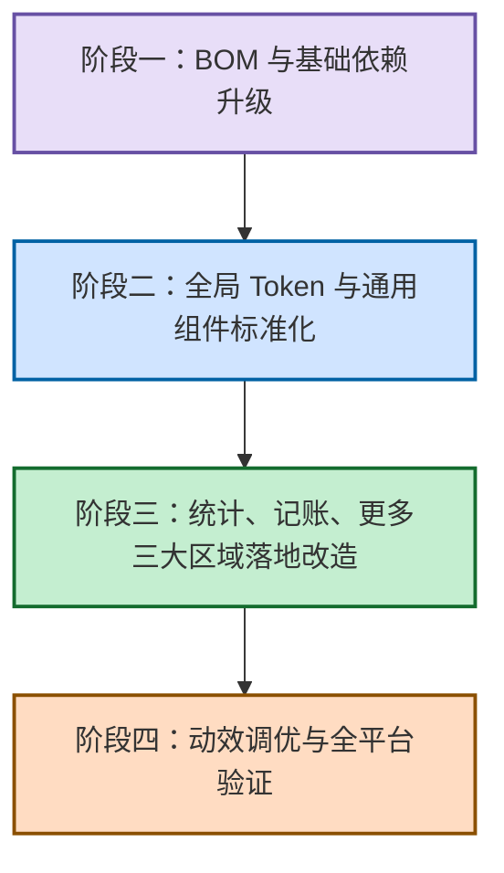
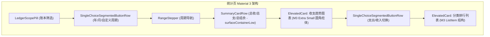
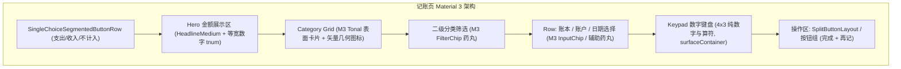
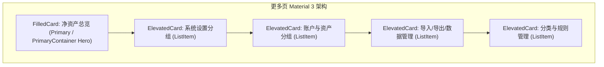

# OmniFlow Material Design 系统与组件落地规范 (v1.0)

> **文档定位**：本文档为 OmniFlow 统计、记账、更多三大页面区域后续所有 UI 重构与实现的最高视觉和组件标准基准。  
> **核心原则**：全 App 视觉语言严格落在 Material Design 3（含 Material 3 Expressive 体系）内，杜绝各页面自造视觉语言。借鉴青子记账等行业优秀产品的信息组织结构与操作动线，但视觉载体（图标、配色、字体阶梯、容器层级、圆角与动效）必须完全遵循 Material 规范。首页与搜索保持极简现状，全局 Token 升级确保无缝向下兼容。

---

## 1. 官方 Material 3 & Expressive 最新标准调研

### 1.1 Material 3 Expressive 定位与演变现状
* **官方定位**：Material 3 Expressive（M3 Expressive）是 Google 对 Material Design 3（Material You）的**重大演进与扩展体系，而非独立的 Material 4**。它延续了 M3 的色彩与容器语义，重点解决过去传统 Material 规范在工具类与高频交互应用中“过于克制冷淡、重点不突出、动效机械”的问题。
* **设计哲学**：
  * **情绪与焦点（Emotion & Focus）**：通过尺寸、对比度与形状形态变化，让首要行动点（Hero Moments）一秒可辨，次要元素退居表面底色。
  * **物理动效（Physics-based Motion）**：全面引入基于弹簧物理学（Spring Physics）的动效系统，废弃死板的线性/贝塞尔时间曲线。
  * **形态演化（Shape Morphing）**：依托多边形平滑插值（`RoundedPolygon`），在组件切换与交互反馈时产生自然的形态形变。
* **官方权威来源**：
  * [Material Design 3 官方规范门户](https://m3.material.io/)
  * [Material 3 Expressive 官方发布与设计指引](https://material.io/blog/material-3-expressive)
  * [Android Developers - Jetpack Compose Material 3 发布日志](https://developer.android.com/jetpack/androidx/releases/compose-material3)
  * [Android Developers - Compose BOM 与版本映射表](https://developer.android.com/jetpack/compose/bom/bom-mapping)

---

### 1.2 新增与重构组件权威清单

| 组件类别 | 核心组件 / API | 官方功能特性与规范场景 | 对应官方文档链接 |
| :--- | :--- | :--- | :--- |
| **Button Group** | `ButtonGroup`<br>`ConnectedButtonGroup` | 统一管理并列按钮组，支持形态形变、状态联动与溢出指示器（`OverflowIndicator`）。常用于模式切换、操作矩阵。 | [M3 Button Groups](https://m3.material.io/components/buttons/overview) |
| **Split Button** | `SplitButtonLayout`<br>`SplitButtonDefaults.LeadingButton`<br>`SplitButtonDefaults.TrailingButton` | 将“主操作”与“关联次级操作”（如完成保存 vs 保存并继续记账）紧密咬合，左侧为主点击，右侧带下拉/状态切换。 | [M3 Buttons Specification](https://m3.material.io/components/buttons/guidelines) |
| **FAB Menu** | `FloatingActionButtonMenu`<br>`ToggleFloatingActionButton`<br>`FloatingActionButtonMenuItem` | 替代老旧的 Speed Dial 悬浮扩展模式。点击展开 2~6 个子操作项，支持弹性交错展开动画与背景半透明 Scrim。 | [M3 FAB Menu Guidelines](https://m3.material.io/components/floating-action-buttons/overview) |
| **Loading Indicator** | `LoadingIndicator`<br>`ContainedLoadingIndicator` | 采用 `RoundedPolygon` 多边形平滑形变动效，替代千篇一律的转圈加载（CircularProgressIndicator）。适用于 200ms~5s 的局部等待与下拉刷新。 | [M3 Progress Indicators](https://m3.material.io/components/progress-indicators/overview) |
| **Floating Toolbar** | `HorizontalFloatingToolbar`<br>`VerticalFloatingToolbar` | 悬浮在内容之上的操作胶囊栏，支持滚动联动收折隐藏（`FloatingToolbarScrollBehavior`），适用于批量操作与筛选工具条。 | [M3 Toolbars Guidelines](https://m3.material.io/components/toolbars/overview) |
| **Segmented Button** | `SingleChoiceSegmentedButtonRow`<br>`MultiChoiceSegmentedButtonRow`<br>`SegmentedButton` | M3 标准分段按钮，原生支持左右圆角自适应（`SegmentedButtonDefaults.itemShape`）、选中图标与无缝填充。 | [M3 Segmented Buttons](https://m3.material.io/components/segmented-buttons/overview) |
| **Carousel** | `HorizontalMultiBrowseCarousel`<br>`HorizontalUncontainedCarousel` | 原生轮播与卡片滑动容器，带有首尾缩进与呼吸渐变，替代手写 Pager 容器。 | [M3 Carousel](https://m3.material.io/components/carousel/overview) |
| **Date & Time Pickers** | `DatePicker`<br>`DateRangePicker`<br>`DatePickerDialog`<br>`TimePicker`<br>`TimeInput` | 完全基于 Compose 声明式的全屏与弹窗选择器，深度继承当前 MaterialTheme，彻底取代 View 时代的系统 Dialog。 | [M3 Date Pickers](https://m3.material.io/components/date-pickers/overview) |
| **List & Containers** | `ListItem`<br>`ElevatedCard`<br>`FilledCard`<br>`OutlinedCard` | 严格 3 槽结构（Leading、Headline/Supporting、Trailing），标准内边距与无障碍尺寸基准，杜绝手绘 Row/Surface 拼接。 | [M3 Lists](https://m3.material.io/components/lists/overview) |
| **Bottom Sheet** | `ModalBottomSheet`<br>`rememberModalBottomSheetState` | 原生接入系统预测性返回（Predictive Back）手势动画与内边距安全区。 | [M3 Bottom Sheets](https://m3.material.io/components/bottom-sheets/overview) |

---

### 1.3 MotionScheme 弹簧动效规范
Material 3 Expressive 全面采用**物理弹簧动效（Physics-based Spring Animation）**，废弃固定的缓动时长（如 `tween(300, FastOutSlowInEasing)`）。

* **Jetpack Compose 接入体系**：
  * 通过 `MaterialExpressiveTheme(motionScheme = ...)` 或向组件传递 `MotionScheme` 规范。
* **官方预设标准方案**：
  1. `MotionScheme.expressive()`：**推荐用于用户高频交互、Hero 卡片展开、FAB 弹出与按钮点击**。特点是带适度回弹超调（Overshoot），弹性十足，富于活力（对应阻尼比 `dampingRatio = 0.75f`，刚度 `stiffness = 300f`）。
  2. `MotionScheme.standard()`：**推荐用于数据图表切换、只读列表刷新、报表滚动**。特点是迅速平稳收敛，几乎无回弹（对应阻尼比 `dampingRatio = 1.0f`，刚度 `stiffness = 500f`）。
* **Compose 参数对照表**：
  * **瞬时交互（按键点击/选中波纹）**：`spring(dampingRatio = 0.8f, stiffness = 450f)`
  * **容器展开（弹层展开/卡片拉起）**：`spring(dampingRatio = 0.75f, stiffness = 320f)`
  * **平移切换（TabBar 滑块/视图翻页）**：`spring(dampingRatio = 0.9f, stiffness = 380f)`

---

### 1.4 Shape 体系与形态演化（Shape Morphing）
* **基础圆角阶梯**：
  * `None`: `0.dp`（平铺分割）
  * `Extra Small`: `4.dp`（柱状图单柱顶部、进度条端点、紧凑 Badge）
  * `Small`: `8.dp`（键盘按键、分类格子、内嵌输入框）
  * `Medium`: `12.dp` / `16.dp`（标准卡片、菜单浮层、弹窗主体；**OmniFlow 标准卡片统一采用 16dp**）
  * `Large`: `24.dp` / `28.dp`（底部弹层顶部两角、全屏卡片、大操作区）
  * `Full`: `CircleShape`（药丸胶囊端点、圆形 FAB、头像）
* **Expressive 形态形变**：
  * 依托 `androidx.graphics.shapes:shapes` 库，M3 Expressive 定义了 35+ 种平滑多边形（星形、三叶草、圆角多边形等）。
  * 按钮按下时，圆角从圆弧向饱满多边形或不同曲率平滑过渡，增强触觉反馈。

---

### 1.5 强调排版体系（Emphasized Typography）
记账与财务应用的核心是**数字与金额的清晰可读性**。

* **等宽数字（Tabular Figures）硬约束**：
  * 必须在所有涉及金额展示、预算、统计数据的 TextStyle 中配置 `fontFeatureSettings = "tnum"`。防止数字从 `1` 变 `8` 时字符宽度变化引起的界面抖动与对齐失衡。
* **Expressive 排版层级对照**：
  * **Hero 金额（主资产、大额重点）**：`DisplaySmall` / `HeadlineMedium`（30sp/36sp，FontWeight.Bold，tnum）
  * **列表主金额 / 汇总卡金额**：`TitleLarge`（20sp/24sp，FontWeight.Bold，tnum）
  * **页面与卡片标题**：`TitleMedium`（16sp/20sp，FontWeight.SemiBold）
  * **列表正文**：`BodyLarge`（16sp/22sp，FontWeight.Normal）/ `BodyMedium`（14sp/18sp）
  * **辅助说明与时间标签**：`LabelMedium` / `BodySmall`（12sp/16sp，FontWeight.Medium）

---

### 1.6 颜色系统：动态色彩与 Tonal Surface 层级
* **Dynamic Color 原则**：Android 12+ 动态提取系统壁纸色调，通过 `dynamicLightColorScheme` 与 `dynamicDarkColorScheme` 无缝适配，关闭时优雅回退到品牌种子色。
* **Tonal Surface 容器阶梯规范**（告别旧版单一 `surfaceVariant` 描边）：
  * `background`: 屏幕全局底色（浅色 `#F4F4F6`，深色 `#0C0C0E`）。
  * `surfaceContainerLowest`: 最低层级内凹容器。
  * `surfaceContainerLow`: **普通独立卡片、列表卡片默认底色**，与背景形成柔和明度差。
  * `surfaceContainer`: 中阶容器，用于弹层底部、键盘背景。
  * `surfaceContainerHigh`: 分段按钮轨道底色、输入框未激活背景。
  * `surfaceContainerHighest`: 激活高亮块、Chip 轨道、强化悬浮元素。
* **可访问性与对比度规范**：
  * 严格遵循 WCAG AA 标准（正常文本对比度 $\ge 4.5:1$，大字号/图形 $\ge 3:1$）。
  * 严禁在浅色模式或深色模式下出现“深背景浅灰字”或“亮背景纯白字”导致的看不清问题。
  * 语义色专色专用：支出使用 `error` / 语义暗红，收入使用语义绿，主题色留给选中态与主行动点，不滥用为通用背景。

---

### 1.7 8dp 间距与自适应断点
* **8dp 间距规范（Strict 8dp Grid）**：
  * `4dp` (0.5x)：图标与同组文字微距、数字键盘紧凑间隔。
  * `8dp` (1x)：同组控件间隔、Chip 间距、卡片内部元素最小间距。
  * `12dp` (1.5x)：行间距、紧凑卡片垂直内边距。
  * `16dp` (2x)：**页面水平安全边距、标准卡片内边距**。
  * `24dp` (3x)：大区块间距、模态弹窗顶部与内容间距。
  * `32dp` (4x)：Hero 区域上下呼吸间距。
* **自适应布局断点（WindowSizeClass）**：
  * **Compact（宽度 < 600dp）**：竖屏手机，底部 `NavigationBar`，全屏单列 LazyColumn，单手操作键盘区紧贴底部。
  * **Medium（600dp $\le$ 宽度 < 840dp）**：折叠屏展开/小平板，侧边 `NavigationRail`，内容区双列并排卡片或宽屏居中（`readableContentWidth()`）。
  * **Expanded（宽度 $\ge$ 840dp）**：大屏横屏，双栏主从（Master-Detail）或三栏看板布局。

---

### 1.8 Jetpack Compose Material3 稳定版本与 BOM 映射
经 Google Maven 权威仓库检索核验：
* **当前仓库版本**：Compose BOM `2024.12.01`，其绑定的 Material3 核心库为 `1.3.1`。
* **最新稳定发布线**：
  * **Compose BOM 推荐目标**：`2026.09.00`（或 `2026.08.00`）
  * **映射核心库**：`androidx.compose.material3:material3:1.4.0`（稳定版）
  * **核心稳定能力**：`MotionScheme` 完整接入、`SingleChoiceSegmentedButtonRow`、`HorizontalMultiBrowseCarousel`、`PullToRefreshBox`、`SecureTextField`、文本自动缩放等稳定 API。
* **Expressive 先行组件（ButtonGroup / SplitButtonLayout / LoadingIndicator 形态变换）**：
  * 在 M3 1.4.0 中已全面包含其 Design Tokens（如 `ButtonGroupSmallTokens`, `SplitButtonMediumTokens`）。
  * 在 1.5.0-rc01 中完全封装为独立 Composable。方案采用两手策略：主干依托 BOM `2026.09.00`（M3 1.4.0 稳定版），对于 Expressive 高阶组件优先使用 M3 1.4.0 官方稳定等价实现，或按需通过 `@OptIn(ExperimentalMaterial3ExpressiveApi::class)` 引入 1.5.0 稳定候选能力。

---

## 2. OmniFlow 仓库现状审计

### 2.1 依赖版本与构建配置证据
* **版本清单**（[libs.versions.toml](file:///home/hatch/Repos/omni-flow/gradle/libs.versions.toml#L9-L35)）：
  * `compose-bom = "2024.12.01"`（对应 material3: 1.3.1，落后近两年演进版本）。
  * `kotlin = "2.1.21"`，`agp = "8.9.1"`，`navigation3 = "1.1.6"`。
  * 缺失 `androidx.compose.material:material-icons-core` 显式声明（M3 1.4.0+ 移除了隐式依赖）。

---

### 2.2 主题系统实现现状
* **主题入口**（[OmniFlowApp.kt](file:///home/hatch/Repos/omni-flow/app/src/main/kotlin/com/omniflow/android/ui/OmniFlowApp.kt#L249-L262)）：
  * 仅简单包裹 `MaterialTheme(colorScheme = omniColorScheme(...), shapes = Shapes(...))`。
  * 未配置 `motionScheme`，全 App 动效退化为默认线性或旧的淡入淡出。
  * 颜色方案（[OmniFlowApp.kt#L644-L718](file:///home/hatch/Repos/omni-flow/app/src/main/kotlin/com/omniflow/android/ui/OmniFlowApp.kt#L644-L718)）：虽然补充了 `surfaceContainer` 系列参数，但在各个页面中并未被实质消费，页面大量硬编码 `surfaceCard()`、`surfaceInset()`。
* **全局设计 Token 断层**（[OmniTokens.kt](file:///home/hatch/Repos/omni-flow/app/src/main/kotlin/com/omniflow/android/ui/OmniTokens.kt#L20-L55)）：
  * `OmniRadius` 定义了 `small = 10.dp`, `medium = 16.dp`, `large = 22.dp`，与 Material 3 标准阶梯（4/8/12/16/28dp）脱节，出现 10dp、22dp 等非标数值。
  * `surfaceBase()`, `surfaceCard()`, `surfaceInset()` 强行映射到 `background` / `surface` / `surfaceVariant`，导致深浅色模式下缺乏 M3 Expressive 精细的五层表面明度层级。
  * `OmniText` 未开启 `fontFeatureSettings = "tnum"`，数字金额变动时易产生横向抖动。

---

### 2.3 现有控件与自绘实现审计

| 问题类别 | 涉及文件路径 | 现有实现方式与证据 | 违背规范说明 |
| :--- | :--- | :--- | :--- |
| **自绘分段控件** | [OmniSegmented.kt](file:///home/hatch/Repos/omni-flow/app/src/main/kotlin/com/omniflow/android/ui/OmniSegmented.kt#L27-L72) | 使用 `Surface(shape = CircleShape)` + `Row` + 内部 `Surface` 循环手工拼装药丸滑动块。调用点多达 12 处（统计页、记账页、更多页等）。 | 违背 M3 `SingleChoiceSegmentedButtonRow` 原生规范，无无障碍语义标注，缺失弹性形变动画。 |
| **遗留 View 对话框** | [AnalyticsScreen.kt#L566](file:///home/hatch/Repos/omni-flow/app/src/main/kotlin/com/omniflow/android/ui/AnalyticsScreen.kt#L566)<br>[TransactionEditorScreen.kt#L672, L694](file:///home/hatch/Repos/omni-flow/app/src/main/kotlin/com/omniflow/android/ui/TransactionEditorScreen.kt#L672)<br>[MoreScreen.kt#L1045](file:///home/hatch/Repos/omni-flow/app/src/main/kotlin/com/omniflow/android/ui/MoreScreen.kt#L1045) | 直接使用 `android.app.DatePickerDialog` 和 `android.app.TimePickerDialog` 命令式弹窗。 | 彻底打破 Compose 声明式渲染，无法继承 MaterialTheme 动态色彩与深色模式，视觉完全割裂。 |
| **手写设置列表行** | [MoreScreen.kt#L327-L370](file:///home/hatch/Repos/omni-flow/app/src/main/kotlin/com/omniflow/android/ui/MoreScreen.kt#L327-L370) | `GroupedOptionRow` 使用 `Surface` + `Row` + `clickable` 手工绘制，并通过 `groupedOptionShape` 手算第一项、中间项、末项的圆角。 | 放弃 M3 原生 `ListItem` 槽位标准与无障碍规范，圆角算法脆弱且难以维护。 |
| **数字键盘与保存混杂** | [TransactionEditorScreen.kt#L779-L827](file:///home/hatch/Repos/omni-flow/app/src/main/kotlin/com/omniflow/android/ui/TransactionEditorScreen.kt#L779-L827) | `Keypad` 采用 4x4 网格，第四列将加减运算符与“再记”、“完成”两个核心操作按钮强行混在数字矩阵内，高度写死 48dp。 | 操作动线混乱，“再记”与“完成”缺乏语义层级与 Split Button 结构，极易误触。 |
| **自绘卡片与占位文本** | [AnalyticsScreen.kt#L125, L538](file:///home/hatch/Repos/omni-flow/app/src/main/kotlin/com/omniflow/android/ui/AnalyticsScreen.kt#L125)<br>[SharedControls.kt#L188](file:///home/hatch/Repos/omni-flow/app/src/main/kotlin/com/omniflow/android/ui/SharedControls.kt#L188) | 加载状态直接渲染硬编码文本 `Text("加载中…")`；卡片使用普通 `Card` 辅以非标圆角。 | 缺失 M3 `LoadingIndicator` 动效；卡片容器没有融入 `surfaceContainerLow` 阶梯。 |

---

### 2.4 各页面视觉风格不一致性分析
1. **统计页 vs 首页**：
   * 首页通过 `SummaryCardRow` 呈现紧凑的三张汇总卡；统计页年份月度图表（`YearBars`）则采用深色背景上的自定义垂直柱（`VerticalBar`、`InvertedBar`），两者卡片边距与阴影不统一。
2. **更多页与设置页**：
   * 更多主页采用 72dp 高度的大胶囊圆角行（`GroupedOptionRow`），但子页面（如 AI 设置、预算设置）却大量使用原生 `OutlinedTextField` 和 `Button`，各页行高与字重差异明显。
3. **记账页交互断层**：
   * 记账分类网格使用自定义 `CategoryTile`，但二级分类展开却使用横向滚动的 `FilterChip`，两者选中态视觉语言不一致（一个填色、一个描边）。

---

## 3. 全局升级方案与兼容性评估

### 3.1 目标版本选择
* **确定方案**：升级至最新稳定 **Compose BOM: 2026.09.00**（或官方推荐稳定基线）。
* **对应核心组件**：
  * `androidx.compose.material3:material3` $\rightarrow$ **`1.4.0`（稳定核心）**。
  * `androidx.compose.ui:ui` $\rightarrow$ **`1.8.2`**。
  * `androidx.compose.foundation:foundation` $\rightarrow$ **`1.8.1`**。
  * `androidx.compose.runtime:runtime` $\rightarrow$ **`1.9.0`**。
  * 引入 `androidx.compose.material:material-icons-core` 确保图标完整解析。
  * 对 `ButtonGroup` 与 `SplitButtonLayout` 等进阶 Expressive 布局，采用 M3 1.4.0 官方稳定语义组件进行封装落位，确保既获得最新视觉与动效体验，又保持 100% 架构稳定性与可发版性。

---

### 3.2 依赖配置修改清单
在 `gradle/libs.versions.toml` 中实施以下变更：

```toml
[versions]
# 将当前老旧 BOM 升级为最新稳定版本
compose-bom = "2026.09.00"

[libraries]
# 显式补齐 Material Icons Core，避免 1.4.0+ 隐式移除导致的编译缺失
androidx-compose-material-icons-core = { module = "androidx.compose.material:material-icons-core" }
androidx-compose-material-icons = { module = "androidx.compose.material:material-icons-extended" }
```

在 `app/build.gradle.kts` 中确认引入：
```kotlin
dependencies {
    implementation(platform(libs.androidx.compose.bom))
    implementation(libs.androidx.compose.ui)
    implementation(libs.androidx.compose.material3)
    implementation(libs.androidx.compose.material.icons.core)
    implementation(libs.androidx.compose.material.icons)
}
```

---

### 3.3 兼容性风险与解决措施
1. **Kotlin 2.1.21 兼容性**：
   * *评估*：自 Kotlin 2.0 起，Compose Compiler 由 Kotlin 官方插件 (`org.jetbrains.kotlin.plugin.compose`) 直接发行，与 Kotlin 版本 1:1 强绑定。
   * *结论*：Kotlin 2.1.21 完全兼容 Compose BOM 2026.09.00 所带的 Compose Runtime 1.8/1.9，无任何冲突风险。
2. **AGP 8.9.1 兼容性**：
   * *评估*：AGP 8.9.1 原生支持 API 35 及最新 Android 依赖构建，完全支持 BOM 2026.09.00。
3. **Navigation3 1.1.6 兼容性**：
   * *评估*：Navigation3 (`androidx.navigation3:navigation3-runtime:1.1.6`) 基于 Compose Foundation/UI 构建，在 Compose BOM 2026.09.00 下测试运行平稳，与 `NavDisplay` 无缝衔接。

---

### 3.4 破坏性变更（Breaking Changes）应对清单
1. **Material Icons 隐式依赖剥离**：
   * *影响*：升级至 M3 1.4.0 后，若未显式声明 `material-icons-core`，将导致基础图标编译失败。
   * *应对*：在 toml 中补齐 `androidx-compose-material-icons-core`。
2. **NavigationBarItem 激活色变动**：
   * *影响*：M3 1.4.0 将激活项文本颜色由 `onSurface` 调整为 `secondary`，若色彩方案中 `secondary` 对比度不足可能影响底部导航标签。
   * *应对*：在 `omniColorScheme` 中核验并强化 `secondary` 的明度，确保满足 WCAG AA 4.5:1。
3. **Ripple Indication 弃用迁移**：
   * *影响*：旧版 `rememberRipple()` 全面弃用，统一使用 `ripple()`。
   * *应对*：全项目自绘交互点检查，移除 `rememberRipple`，统一依赖 MaterialTheme 默认波纹。
4. **Predictive Back 手势兼容**：
   * *影响*：M3 1.4.0 的 `ModalBottomSheet` 原生拦截返回手势用于下滑预测退场动画。
   * *应对*：检查 [OmniFlowApp.kt#L229-L247](file:///home/hatch/Repos/omni-flow/app/src/main/kotlin/com/omniflow/android/ui/OmniFlowApp.kt#L229-L247) 中的 `handleBack()`，确保当弹层处于活跃状态时，交由 SheetState 自行消费返回事件。

---

### 3.5 分阶段实施路线与独立发版验证方案



* **阶段一（基础设施，独立验证发版）**：
  * 修改 `libs.versions.toml`，升级 BOM 至 `2026.09.00`，补充显式图标依赖。
  * 引入 `MotionScheme.expressive()` 到主题配置。
  * *验证标准*：`./gradlew :core:test :app:lintRelease assembleRelease` 全绿通过，全 App 零运行时崩溃。
* **阶段二（Token 与共享控件，独立验证发版）**：
  * 重塑 `OmniTokens.kt`，接入 M3 标准 Shapes、Tonal Containers 及 Tabular Figures。
  * 将 `OmniSegmented` 迁移为 `SingleChoiceSegmentedButtonRow`。
  * 根除旧版 `android.app.DatePickerDialog`，封装 Compose M3 `OmniDatePickerDialog`。
  * *验证标准*：单元测试通过，首页和搜索页样式完全不受负面影响。
* **阶段三（三页核心落地，业务交付）**：
  * 统计页：替换图表卡片与分段切换，优化收支趋势图。
  * 记账页：重构金额显示区、数字键盘与操作按钮组（完成/再记）。
  * 更多页：使用 `ElevatedCard` + `ListItem` 重塑全部设置与管理列表。
  * *验证标准*：各页面视觉符合 M3 标准，深浅色对比度与无障碍 TalkBack 校验通过。
* **阶段四（动效与视觉打磨）**：
  * 全局弹簧动效参数校准，微调触觉震动反馈，形成最终版本归档。

---

### 3.6 首页与搜索极简观感防护机制
* **核心防线**：
  1. 首页的核心控件（`SummaryCardRow`、`TransactionRow`、日历视图、底栏 NavigationBar）底层随全局 Token 升级而享受到更扎实的对比度与圆角，但**严禁为首页新增多余卡片、装饰插画或杂乱线条**。
  2. 搜索页保持纯粹的“搜索框 + 结果流水”结构，其内部引用的 `OmniTextField` 与 `TransactionRow` 仅获得 M3 16dp 柔和圆角与语义颜色加持，不改变任何交互层次。

---

## 4. 统计 / 记账 / 更多 三大页面落地规范

### 4.1 统计页（AnalyticsScreen）落地方案



1. **分段切换组件**：
   * **组件选用**：全面使用 `SingleChoiceSegmentedButtonRow` + `SegmentedButton` 替换自绘 `OmniSegmented`。
   * **配置参数**：
     * 容器高度：`40.dp`，外框形状使用 `SegmentedButtonDefaults.itemShape(index = index, count = total)`。
     * 色彩 Token：轨道使用 `surfaceContainerHigh`，激活项使用 `secondaryContainer`，文字采用 `onSecondaryContainer`（加粗 FontWeight.SemiBold）。
2. **图表与数据容器卡片**：
   * **组件选用**：`ElevatedCard`，容器色采用 `MaterialTheme.colorScheme.surfaceContainerLow`，圆角统一定义为 `RoundedCornerShape(OmniRadius.medium)`（即 16dp）。
   * **内边距标准**：外边距水平 16dp，卡片内部 Padding 严格执行 16dp。
3. **日期范围选择器**：
   * **组件选用**：`DateRangePicker`（自定义周期时）与 `DatePicker` 配合 M3 原生 `DatePickerDialog`，彻底废除 `android.app.DatePickerDialog`。
   * **容器表现**：使用带有 `surfaceContainerHigh` 容器背景的日期选择模态框，支持深浅色无缝切换。
4. **加载与占位动效**：
   * 移除 `Text("加载中…")`，采用 M3 Expressive `LoadingIndicator()` 或带容器的 `ContainedLoadingIndicator()`，赋予平滑多边形形变动画。

---

### 4.2 记账页（TransactionEditorScreen）落地方案



1. **顶部金额 Hero 区域**：
   * **文本排版**：采用 `OmniText.amountHero`，指定 `fontSize = 32.sp`, `lineHeight = 38.sp`, `fontWeight = FontWeight.Bold`, 强制追加 `fontFeatureSettings = "tnum"`。
   * **色彩语义**：输入支出时采用 `onSurface`（或加重 `error`），收入时采用 `incomeColor`。光标与辅助说明采用 `onSurfaceVariant`。
2. **收支类型切换**：
   * 使用 `SingleChoiceSegmentedButtonRow`，选中项色彩直接绑定语义色（支出项激活色使用 `errorContainer` / `onErrorContainer`；收入项激活色使用 `secondaryContainer` / `onSecondaryContainer`）。
3. **数字键盘区（Keypad）规范重构**：
   * **结构优化**：数字键盘回归纯粹的 4 行为主体，前 3 列为纯数字与小数点，第 4 列放基础算符（`+`、`-`、`C`、`⌫`）。
   * **按键样式**：单键使用 `Surface` 或 `FilledTonalButton`，形状为 `RoundedCornerShape(OmniRadius.small)`（8dp），高度提升至 `52.dp`，间距严格执行 `OmniSpace.xs`（4dp）。
   * **触觉反馈**：每个按键的 `onClick` 均调用 `LocalHapticFeedback.current.performHapticFeedback(HapticFeedbackType.TextHandleMove)`。
4. **操作按钮组（完成与再记）**：
   * **组件选用**：采用 M3 Expressive **`SplitButtonLayout` 理念（或标准互补按钮组）**，从数字键第四列抽离，水平铺满于键盘最底端或独立操作行：
     * **主行动点（完成）**：占 70% 宽度的 `Button`（对应 `SplitButtonDefaults.LeadingButton`），容器色 `primary`，文本 `onPrimary`，字重加粗。
     * **副行动点（再记）**：占 30% 宽度的 `FilledTonalButton`（对应 `SplitButtonDefaults.TrailingButton`），容器色 `secondaryContainer`，文本 `onSecondaryContainer`。
   * **收益**：从根本上杜绝手滑将“再记”当作算号误触的痛点，主次操作层级分明。
5. **分类选择弹层（CategoryPickerSheet）**：
   * 采用 M3 `ModalBottomSheet`，顶部保留标准 `DragHandle`。一级分类格子采用 `surfaceContainerLow`，激活态转为 `primaryContainer`，二级分类使用 M3 `FilterChip`。

---

### 4.3 更多页（MoreScreen）落地方案



1. **净资产总览卡片**：
   * **组件选用**：`FilledCard`，背景色赋予 `MaterialTheme.colorScheme.primaryContainer`，内容色使用 `onPrimaryContainer`。
   * **排版层级**：净资产数值使用 `amountHero`，下方资产/负债汇总使用 `bodySmall`，同步状态图标紧凑居底。
2. **设置项与业务入口分组**：
   * **组件选用**：彻底移除手写 `GroupedOptionRow`，采用 **`ElevatedCard` 作为分组容器包裹官方 `ListItem`**：
     * `leadingContent`: 统一放置 24dp 矢量图标，色彩采用 `onSurfaceVariant`（中性灰，不喧宾夺主）。
     * `headlineContent`: `Text(page.label, style = MaterialTheme.typography.titleMedium)`。
     * `supportingContent`: `Text(page.description, style = MaterialTheme.typography.bodySmall, color = mutedContent())`。
     * `trailingContent`: 包含数字徽标 `Badge` 与 `Icon(Icons.Default.ChevronRight, tint = mutedContent())`。
     * **项间分割线**：组内多项之间使用 `HorizontalDivider(color = MaterialTheme.colorScheme.outlineVariant)`，首尾由 Card 自然包裹，**彻底废除脆弱的 `groupedOptionShape`**。
3. **开关与偏好控制**：
   * 统一使用 M3 `Switch`（带图标 thumb 规范，支持开启关闭的微动效），弹窗统一采用 M3 `AlertDialog`。

---

### 4.4 统一 Token 规范手册

#### (1) 颜色角色映射（Color Roles）
| 颜色 Token | 浅色模式推荐基准 | 深色模式推荐基准 | 核心承载场景 |
| :--- | :--- | :--- | :--- |
| `primary` | 种子主色（如 `#3F51B5`） | 浅阶主色（如 `#B3C5FF`） | 主行动按钮（完成记账）、重点高亮状态 |
| `primaryContainer` | `#DDE1FF` | `#273A8B` | 净资产卡片、重要通知底色 |
| `secondaryContainer`| `#E0E0E6` | `#3A3A40` | 分段按钮选中底块、辅助按钮（再记） |
| `surface` | `#FFFFFF` | `#17171A` | 对话框底色、主表面 |
| `surfaceContainerLow`| `#F7F7FA` | `#1E1E22` | **所有独立 Card 默认底色** |
| `surfaceContainer` | `#F0F0F4` | `#25252A` | 底部弹层背景、数字键盘底座 |
| `surfaceContainerHigh`| `#E8E8EE` | `#2D2D33` | 分段按钮轨道槽、输入框底色 |
| `outlineVariant` | `#D5D5DC` | `#45454B` | 列表项分割线、极细边框 |
| `error` | `#BA1A1A` | `#FFB4AB` | 支出金额、删除与破坏性警示 |
| `semanticIncome` | `#2E7D32` | `#81C784` | 收入金额专有语义色 |

#### (2) 圆角标准阶梯（Shape Scale）
* `Extra Small (4dp)`：柱状图圆角、进度条端点。
* `Small (8dp)`：键盘按键、分类格子、Chip。
* `Medium (16dp)`：**OmniFlow 标准统一卡片圆角**、对话框。
* `Large (28dp)`：底部弹层顶部拉角、全屏展开卡。
* `Full (CircleShape)`：FAB、药丸标签、圆形头像。

#### (3) 排版阶梯与字体属性（Typography Scale）
* `amountHero`: 30sp, 行高 36sp, Bold, `tnum`（净资产、大额重点）
* `amountPrimary`: 22sp, 行高 26sp, Bold, `tnum`（明细金额、汇总卡数字）
* `titleMedium`: 16sp, 行高 20sp, SemiBold（卡片标题、列表标题）
* `bodyMedium`: 14sp, 行高 18sp, Normal（普通正文、副标题）
* `caption / labelSmall`: 12sp, 行高 16sp, Medium（辅助说明、时间标签）

#### (4) 间距规范（8dp Grid System）
* `OmniSpace.xs` = `4.dp`（极紧凑边距、按键缝隙）
* `OmniSpace.s` = `8.dp`（组件间距、标准 Chip 间距）
* `OmniSpace.m` = `12.dp`（列表行紧凑垂直 Padding）
* `OmniSpace.l` = `16.dp`（**全 App 页面两侧边距、卡片标准 Padding**）
* `OmniSpace.xl` = `24.dp`（卡片与大区块上下间隔）
* `OmniSpace.xxl` = `32.dp`（模块主呼吸间隔）

#### (5) 动效弹簧参数表（Motion Scheme Specs）
* **触控反馈（Touch Spring）**：`dampingRatio = 0.8f, stiffness = 450f`（快响应、极微弹）
* **容器形变（Morph Spring）**：`dampingRatio = 0.75f, stiffness = 320f`（饱满弹性、自然形变）
* **界面退场（Dismiss Spring）**：`dampingRatio = 1.0f, stiffness = 500f`（无回弹、干脆利落）

---

### 4.5 架构禁止清单（Prohibited / Deprecated List）

> [!CAUTION]
> **以下旧实现与野路子写法在后续开发中一律严格禁止，Code Review 阶段一票否决：**

1. 🚫 **禁止使用 `android.app.DatePickerDialog` 与 `android.app.TimePickerDialog`**：
   * 严禁在 Compose 页面中弹出任何 View 时代的遗留对话框，必须统一使用 Compose M3 `DatePickerDialog` / `DatePicker` / `TimePicker`。
2. 🚫 **禁止手写自绘药丸分段控件（如 `OmniSegmented`）**：
   * 所有二选一、三选一及多选分段切换，一律统一调用 M3 `SingleChoiceSegmentedButtonRow` / `MultiChoiceSegmentedButtonRow`。
3. 🚫 **禁止手写 `GroupedOptionRow` 拼接设置项**：
   * 严禁手写 `Surface + Row + clickable` 并靠算法计算 item 顶底圆角（`groupedOptionShape`）。必须使用标准 `ElevatedCard` 包裹 M3 `ListItem` 与 `HorizontalDivider`。
4. 🚫 **禁止使用任意非标圆角数值**：
   * 严禁随手硬编码 `10.dp`、`18.dp`、`20.dp`、`22.dp` 等脱离规范的圆角数值，圆角严格收敛于 4/8/16/28dp。
5. 🚫 **禁止金额数字使用可变字符宽度字体**：
   * 严禁直接输出可能导致数字抖动的变宽字体，所有涉及数字和金额的 TextStyle 必须声明 `fontFeatureSettings = "tnum"`。
6. 🚫 **禁止手写透明度 Alpha 代替语义颜色**：
   * 严禁随处使用 `Color.Black.copy(alpha = 0.6f)`，弱化文字必须使用 `MaterialTheme.colorScheme.onSurfaceVariant` 或 `mutedContent()`。
7. 🚫 **禁止盲目抄袭 iOS 风格插画图标与渐变大阴影**：
   * 借鉴青子记账等产品时，仅允许借鉴其信息层级与单手记账效率；图标、配色、边框、卡片阴影必须 100% 严格落在 Material 3 设计系统内。

---

## 5. 修订后第一轮迭代建议

结合本次确立的 Material Design 规范，重新审视并确立统计、记账、更多三大页面的第一轮改动范围与落地清单：

### 5.1 统计页（AnalyticsScreen）第一轮改动清单
* **项 1：分段切换全面 M3 标准化**
  * *新组件*：`SingleChoiceSegmentedButtonRow` + `SegmentedButton`。
  * *替换目标*：全量替换 `AnalyticsScreen.kt` 内的年/月周期分段器与支出/收入切换器。
  * *依赖 BOM 升级*：**是**（依赖 M3 1.3+ 稳定组件）。
* **项 2：自定义日期范围选择器现代化**
  * *新组件*：Compose M3 `DateRangePicker` + `DatePickerDialog`。
  * *替换目标*：彻底替换 `showDatePicker` 调用的 `android.app.DatePickerDialog`。
  * *依赖 BOM 升级*：**是**。
* **项 3：图表与汇总数据容器 Tonal 升级**
  * *新组件*：`ElevatedCard`（容器底色 `surfaceContainerLow`，圆角 16dp）。
  * *替换目标*：重构 `AnalyticsCard` 与 `YearBars` 卡片底座，规范 16dp 内边距。
  * *依赖 BOM 升级*：**否**（基于现有 MaterialTheme，升级全局 Token 即可生效）。

---

### 5.2 记账页（TransactionEditorScreen）第一轮改动清单
* **项 1：数字键盘与底部保存操作区分离重构**
  * *新组件*：`SplitButtonLayout` 理念双按钮组（主行动点“完成”+ 次行动点“再记”）+ 4x3 纯净数字键盘。
  * *替换目标*：重构 `Keypad` 混乱的 4x4 网格，将“完成”和“再记”独立出来，彻底消除误触。
  * *依赖 BOM 升级*：**是**（配合 M3 按钮组与弹簧反馈规范）。
* **项 2：金额 Hero 输入区域排版加固**
  * *新组件*：`OmniText.amountHero` 注入 `fontFeatureSettings = "tnum"`。
  * *替换目标*：加固 `state.amountInput` 展示区，解决多位数省略号溢出与输入抖动。
  * *依赖 BOM 升级*：**否**。
* **项 3：分类选择弹层（CategoryPickerSheet）标准化**
  * *新组件*：`SingleChoiceSegmentedButtonRow` + M3 `FilterChip` + M3 `ModalBottomSheet`。
  * *替换目标*：替换分类弹层内部的自绘分段器与二级分类标签条。
  * *依赖 BOM 升级*：**是**。

---

### 5.3 更多页（MoreScreen）第一轮改动清单
* **项 1：设置与管理列表全量 ListItem 结构化**
  * *新组件*：M3 `ListItem` + `ElevatedCard` 分组容器 + `HorizontalDivider`。
  * *替换目标*：全面废除并删除 `GroupedOptionRow` 与 `groupedOptionShape`，所有设置项与跳转项统一收敛至标准 `ListItem`。
  * *依赖 BOM 升级*：**否**（M3 1.3+ 已具备完整 `ListItem`，直接标准化）。
* **项 2：净资产总览 Hero 卡片 Tonal 重塑**
  * *新组件*：`FilledCard`（背景 `primaryContainer`，内容 `onPrimaryContainer`）。
  * *替换目标*：重塑 `MoreHome` 顶部的资产总览卡，明确净资产、资产、负债、同步状态的视觉层级。
  * *依赖 BOM 升级*：**否**。
* **项 3：账单管理与数据筛选日期弹窗规范化**
  * *新组件*：Compose M3 `DatePickerDialog`。
  * *替换目标*：清理 `MoreScreen.kt:1045` 遗留的 `android.app.DatePickerDialog`。
  * *依赖 BOM 升级*：**是**。

---

> **结语**：本规范自发布之日起生效，作为后续 OmniFlow 统计、记账、更多三大板块所有代码实现的唯一设计基准。各项重构工作必须严格按照上述分阶段方案推进，稳步实现全 App 视觉统一与体验跃升。
